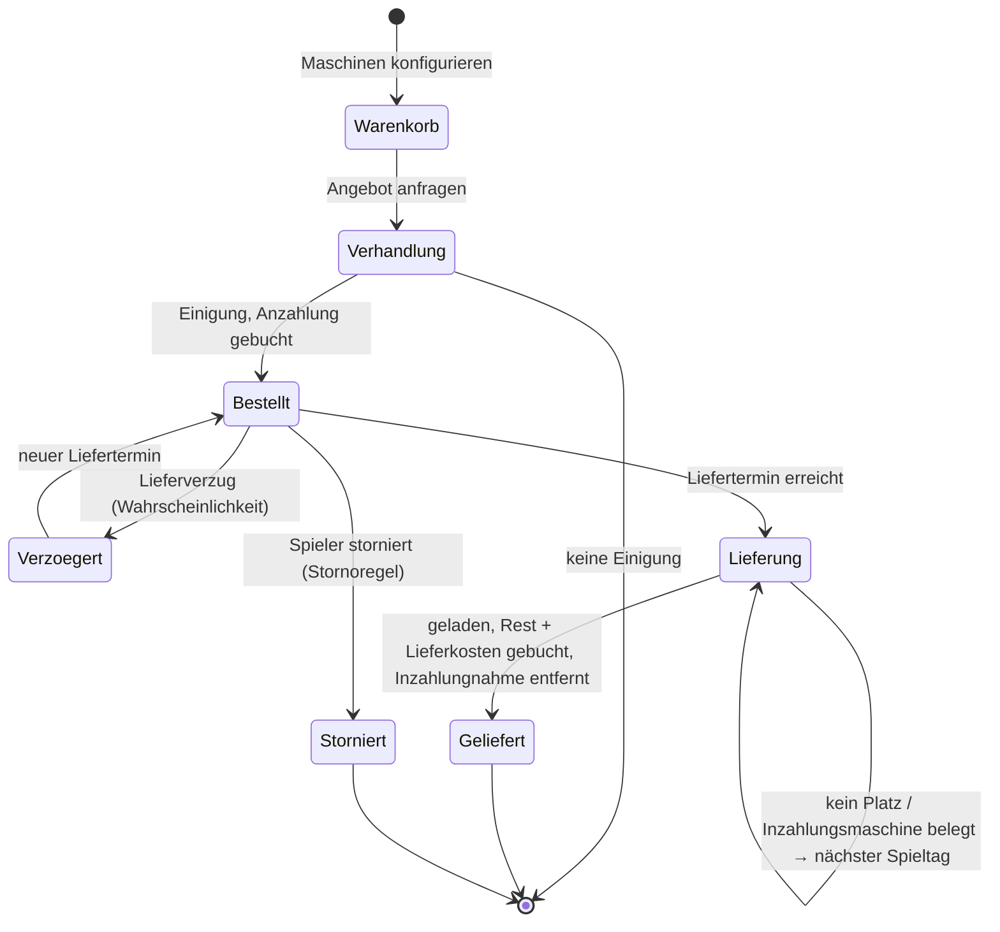

# FarmPulse – Roadmap Fahrzeughändler

Stand 14.10.2026. Ziel: Neue Maschinen kauft der Spieler beim **Landmaschinenhändler im Hof-Tablet**. Er stellt sich
die Maschine wie im Spiel-Shop zusammen (Farbe, Reifen, Motor, Ausstattung …), legt mehrere Maschinen in eine
**Sammelbestellung**, verhandelt den Preis, zahlt an, wartet die **Lieferzeit** ab und bekommt die Maschine an einen
**selbst festgelegten Lieferort** geliefert. Dazu kommen Inzahlungnahme, Stornierung, Finanzierung über die Bank und
eine Vorführmaschine.

Die Roadmap ergänzt [Roadmap V3](ROADMAP_V3.md) (V – Gebrauchtmaschinen) und [Roadmap V3.1](ROADMAP_V3.1.md) (A2 –
Leih- und Vorführmaschine). Die Grundentscheidungen hat der Projektinhaber am 14.10.2026 getroffen (siehe
[Entscheidungen](#entscheidungen-vom-14102026) und `QUESTIONS.md`). Alles, was darüber hinaus festzulegen ist, steht
unter [Offene Punkte](#offene-punkte-vorschläge-zur-bestätigung) und ist **noch nicht entschieden**.

Wie V2 bis V4 enthält die Datei **nur Punkte, die mit der FS25-Schnittstelle machbar sind**. Jeder Punkt mit
Mod-Eingriff wurde am 14.10.2026 gegen den FS25-Quellcode-Dump und die Community-LUADOC geprüft (Quellen am Ende).
Was sich damit nicht belegen lässt, steht unter [Bewusst nicht aufgenommen](#bewusst-nicht-aufgenommen) oder ist als
🟡 mit Fallback markiert.

**Warum das zum Spiel passt:** Der Spiel-Shop kauft selbst über `BuyVehicleData:buy`. Diese Funktion macht nichts
anderes als FarmPulse seit den Gebrauchtmaschinen (R3-V2): Sie füllt ein `VehicleLoadingData` mit Shop-Eintrag,
**Konfigurationen**, Ladeplatz, Besitzstatus und Besitzer und ruft `load` auf. FarmPulse übergibt künftig zusätzlich
die gewählten Konfigurationen und statt des Shop-Platzes auf Wunsch eine eigene Position. Das Spiel lädt Fahrzeuge an
festen Positionen selbst so (`PlaceableVehicle`, `ReceivingHopper`, `SupportVehicle`).

**Grundsätze (unverändert aus V1–V4)**

- Der Mod bleibt **Sensor und Aktuator**: Er liest den Katalog, merkt sich Positionen und lädt Maschinen. Preise,
  Lieferzeiten, Verzug, Rabatte, Lieferkosten und Stornogebühren berechnet das Backend nach festen, konfigurierbaren
  Formeln (`rpsim.formulas.*`). Die KI formuliert nur die Mails des Händlers.
- Jeder Zugriff auf FS25 läuft in `RPSimGameAdapter` und ist mit `pcall` abgesichert. Fehlt eine API, fällt die
  Funktion still auf das bisherige Verhalten zurück (hier: Standardkonfiguration, Shop-Platz).
- Neue Felder in den Bridge-Dateien sind **optional** (`schemaVersion` bleibt `1`).
- Beträge gibt der Spieler nie im Freitext ein, sondern über Formulare. Das Backend legt jeden Preis fest.
- Anweisungen, die Geld bewegen, laufen als **Batch** (alles oder nichts) oder buchen wie `VEHICLE_SPAWN` selbst im
  Lade-Callback.
- Spielmonat = FS25-Periode, gerechnet wird in **Spieltagen** wie bei Lohnunternehmer und Gebrauchtmaschinen.

**Hängt ab von:**

- Fahrzeug-Katalog `market_context.storeVehicles[]` (R3-V1), `VEHICLE_SPAWN` / `VEHICLE_REMOVE` (R3-V2, R3-V3,
  `vehicle/VehicleTradeService`), Verhandlungs-Engine mit `AssetType.VEHICLE` (`negotiation/NegotiationEngine`),
- Leih- und Vorführmaschine mit Preis 0 (R31-A2, `farmwork/MachineLoanService`),
- eigene Maschinen `assets.vehicles[]` mit `value` (`getSellPrice()`), `name`, `xmlFilename`, `category`,
- Kontoauszug `bookings` mit Einzelbuchungen `SHOP_VEHICLE_BUY` und Fahrzeugnamen (R2-B1,
  `docs/dev/bridge-protocol.md`, Mod-Konfig `bookingLogSingleTypes`),
- Kreditantrag mit Verwendungszweck (`credit/*`, `Loan.purpose`), Liquiditätsplanung (R3-K2),
- Taste im Spiel nach dem Muster „FarmPulse: offene Frage“ (R2-F3, `RPSIM_OPEN_PROMPT` in `modDesc.xml`),
- Hinweis im Spiel (`NOTIFICATION`), Aufgaben, Kalender, Tagebuch, Charaktersystem mit Vertrauen.

## Legende

| Zeichen | Bedeutung |
| --- | --- |
| ✅ **Belegt** | Die genutzte Funktion bzw. das Feld steht so im FS25-Code; Fundstelle ist angegeben. |
| 🟡 **Im Spiel prüfen** | Die API existiert, aber ein Detail lässt sich nur im laufenden Spiel klären. Zu jedem 🟡 steht ein Fallback. |
| – | Kein Mod-Eingriff: nur Backend und Oberfläche mit Daten und Anweisungen, die es schon gibt. |

Punkt-IDs: `RFH-<Bereich><Nummer>`, z. B. `RFH-L3`. Alle Pfade sind relativ zum Repo-Root.

## Übersicht und empfohlene Reihenfolge

| Phase | Bereich | Inhalt | Mod-Eingriff | Hängt ab von |
| --- | --- | --- | --- | --- |
| 0 | [Q – Querschnitt](#q--querschnitt) | Katalog mit Konfigurationen, Lieferorte aus dem Spiel, Anweisung `VEHICLE_DELIVERY`, Buchungsgründe, Simulator, Tests, Doku | ja | R3-V1..V3 |
| 1 | [H – Händler](#h--der-händler) | Neue Rolle `MACHINE_DEALER`, Händler-Oberfläche | nein | – |
| 2 | [K – Konfigurator und Sammelbestellung](#k--konfigurator-und-sammelbestellung) | Katalog durchsuchen, Maschine konfigurieren, Warenkorb | nein (über Q1) | Q1, H |
| 3 | [O – Lieferorte](#o--lieferorte) | Lieferort im Spiel per Taste festlegen, benennen, verwalten; Shop-Platz als Standard | ja (über Q2) | Q2 |
| 4 | [B – Angebot, Verhandlung und Bezahlung](#b--angebot-verhandlung-und-bezahlung) | Angebot, Verhandlung, Anzahlung, Finanzierung, Inzahlungnahme, Stornierung | nein | K, H |
| 5 | [L – Lieferzeit und Lieferung](#l--lieferzeit-und-lieferung) | Lieferzeit je Kategorie, Konfig-Zuschlag, Express, Verzug, Lieferung mit Platzprüfung und Ausweichen, Lieferkosten nach Entfernung | ja (über Q3) | Q3, O, B |
| 6 | [S – Spiel-Shop bleibt, der Händler merkt es](#s--spiel-shop-bleibt-der-händler-merkt-es) | Käufe im Spiel-Shop erkennen, Reaktion des Händlers | nein | H |
| 7 | [V – Vorführmaschine](#v--vorführmaschine) | Vorführung einer Katalog-Maschine vor der Bestellung | nein | H, K |

Q zuerst, weil K, O und L den neuen Vertrag brauchen. H und K können parallel laufen. L kommt nach B, weil die
Lieferung den Restbetrag bucht. S und V sind klein und unabhängig. Alle Bereiche funktionieren mit einem älteren Mod
(ohne Q) eingeschränkt: Dann gibt es nur die Standardkonfiguration und nur den Shop-Platz (die Lieferung läuft dann
über das bekannte `VEHICLE_SPAWN`).

### Ablauf einer Bestellung



---

## Entscheidungen vom 14.10.2026

| Thema | Entscheidung |
| --- | --- |
| Was heißt „verlegen“? | Der **Spiel-Shop bleibt**. FarmPulse bekommt einen eigenen Händler. Käufe im Spiel-Shop erkennt FarmPulse und der Händler reagiert im Rollenspiel (Bereich S). |
| Bezahlung | **Anzahlung** bei Bestellung, **Rest bei Lieferung** (im Lade-Callback wie bei Gebrauchtmaschinen). |
| Lieferzeit | **Spanne je Shop-Kategorie**, **Zuschlag für abweichende Konfiguration**, **Expresslieferung** gegen Aufpreis, **Lieferverzug** möglich. |
| Lieferorte | **Taste im Spiel** an der Position des Spielers; der **Shop-Platz** des Spiels bleibt immer wählbar und ist Standard. Kein Klick auf der Hofkarte. |
| Händler | **Neue Rolle** Landmaschinenhändler (`MACHINE_DEALER`), getrennt von der Werkstatt. |
| Preis | Listenpreis inkl. Konfiguration, **Verhandlung** mit der bestehenden Engine. |
| Lieferkosten | **Nach Entfernung** vom Shop-Platz zum Lieferort. |
| Extras | **Inzahlungnahme**, **Stornierung**, **Finanzierung über die Bank**, **Vorführmaschine**, **Sammelbestellung** (mehrere konfigurierte Maschinen in einer Bestellung). |
| Sammelbestellung | Der **Spieler wählt** beim Bestellen: zusammen liefern oder einzeln. |
| Kein Platz am Lieferort | **Ausweichen auf den Shop-Platz**; ist auch der voll, neuer Versuch am nächsten Spieltag. |
| Wert der Inzahlungnahme | **Spielwert** (`getSellPrice()`) als Grundlage, Teil der Verhandlung. |
| Übergabe der Inzahlungsmaschine | **Bei Lieferung**; bis dahin bleibt sie nutzbar. |

---

## Q – Querschnitt

Wie R3-Q, R31-Q und R4-Q legt Q **zuerst den Vertrag** an: Schemas, DTOs, Validator, Normalisierung im Mod,
Simulator und Doku. Das Auslesen im Spiel und die neue Anweisung kommen mit K, O und L.

### RFH-Q1 Katalog mit Konfigurationen

- [ ] Je Katalog-Eintrag zusätzlich (`storeVehicles[]` aus R3-V1 bleibt, die neuen Felder sind optional):
  - `brand` (Rohname der Marke, `storeItem.brandNameRaw`), `dailyUpkeep` (`storeItem.dailyUpkeep`),
    `allowLeasing` nur als Info (Leasing gibt es beim Händler nicht, siehe „Bewusst nicht aufgenommen“),
  - `isBundle` (`storeItem.bundleInfo ~= nil`: mehrere Fahrzeuge in einem Eintrag, z. B. Gespann),
  - `configurations[]` je Konfigurationstyp: `name` (z. B. `baseColor`, `wheel`, `motor`), `title` (Anzeigename
    des Typs), `options[]` je Option mit `index`, `saveId`, `name`, `desc`, `price`, `dailyUpkeep`, `isDefault`,
    `isSelectable`, `color` (nur Farbtypen: `{ r, g, b }`) und `dependent[]` (`{ name, index }`: Optionen, die
    diese Option mit festlegt),
  - `defaultConfigurations` (`storeItem.defaultConfigurationIds`),
  - `configurationSets[]` (Ausstattungspakete des Herstellers): `name`, `isDefault`, `configurations` (`name →
    index`).
- [ ] Der Listenpreis einer Zusammenstellung ist **Grundpreis + Summe der Optionspreise**. Das rechnet das Backend
  genau wie das Spiel (`StoreItemUtil.getDefaultPrice` → `getCosts(storeItem, configurations, "price")`).
- [ ] **Wo der Katalog steht** ist offen (siehe [Offene Punkte](#offene-punkte-vorschläge-zur-bestätigung), Q1):
  eigene Datei `store_catalog.json` einmal je Spielstart oder Details je Maschine auf Anfrage.
- [ ] `docs/dev/bridge-protocol.md` je Feld mit Quelle im FS25-Code.

**Beleg:**

- ✅ `Shop/StoreManager.md` (LUADOC), `loadItem`: Für `species == VEHICLE` lädt das Spiel beim Laden des Shops
  `storeItem.configurations`, `storeItem.defaultConfigurationIds` (`ConfigurationUtil.getConfigurationsFromXML`),
  `storeItem.subConfigurations` und `storeItem.configurationSets`. Dazu `price`, `dailyUpkeep`, `lifetime`,
  `brandIndex`, `brandNameRaw`, `allowLeasing`, `categoryName`. Bei Bundles werden die Optionspreise der Einzelteile
  addiert.
- ✅ `configurations/ConfigurationUtil.lua` (Dump): `getConfigurationsFromXML` (Optionen je Typ, Reihenfolge =
  `index`), `getDefaultConfigIdFromItems` (Standard = erste Option mit `isDefault` und `isSelectable`, sonst erste
  wählbare), `getConfigurationSetsFromXML` (Pakete mit `name`, `isDefault`, `configurations`),
  `getConfigIdBySaveId` / `getSaveIdByConfigId`, `getColorByConfigId`.
- ✅ `Configurations/VehicleConfigurationItem.md` (LUADOC), `new` / `loadFromXML`: Felder `name`, `desc`, `price`,
  `dailyUpkeep`, `isDefault`, `isSelectable`, `saveId`, `isYesNoOption`, `overwrittenTitle`.
- ✅ `Configurations/VehicleConfigurationItemColor.md`: `getColor()` liefert `{ r, g, b }`.
- ✅ `VehicleLoadingData.lua` (Dump), `getConfigurations`: `configItem.dependentConfigurations` (`{ name, index }`)
  setzt abhängige Optionen.
- ✅ `Utils/StoreItemUtil.md`: `getCosts`, `getDefaultPrice`, `getDailyUpkeep`, `getIsConfigurable`.

**🟡 Im Spiel prüfen:**

- Unter welchem Feld steht der **Anzeigename eines Konfigurationstyps**? Er wird als zweites Argument von
  `addConfigurationType(name, title, …)` übergeben (z. B. `Specializations/WorkMode.md`), der Rumpf von
  `addConfigurationType` fehlt aber im Dump. **Fallback:** Die Oberfläche zeigt den technischen Namen über eine
  Übersetzungstabelle im Frontend (`baseColor` → „Farbe“ …), unbekannte Typen mit ihrem Namen.
- Weicht der Preis im Spiel-Shop vom Listenpreis ab? Der Shop rechnet mit `EconomyManager:getBuyPrice(storeItem,
  configurations, saleItem)` (`Shop/BuyVehicleData.md`, `updatePrice`), dessen Rumpf in keiner Quelle steht.
  **Fallback:** FarmPulse nennt den Preis „Listenpreis laut Shop-Daten“ (`getDefaultPrice`).
- Wie groß und wie langsam ist der Export aller Konfigurationen? **Fallback:** Details je Maschine auf Anfrage (Q1,
  Variante B).

### RFH-Q2 Lieferorte aus dem Spiel

- [ ] Neue Taste **„FarmPulse: Lieferort hier festlegen“** (Aktion `RPSIM_SET_DELIVERY_POINT` in `modDesc.xml`,
  Kategorie `ONFOOT`, Standardbelegung offen, in der Steuerung änderbar). Registriert wie `RPSIM_OPEN_PROMPT`.
- [ ] Beim Druck merkt sich der Mod: Position des Spielers (`x`, `y`, `z`), Blickrichtung als Drehung um die
  Hochachse (`ry`), das Flurstück an der Stelle (`farmlandId`) und Spieltag/Uhrzeit. Hinweis im Spiel: „Lieferort
  gespeichert – im Hof-Tablet benennen“.
- [ ] `farm_facts.json`, neuer optionaler Block `deliveryPoints[]` = `{ seq, x, y, z, ry, farmlandId, day, dayTimeMs }`:
  die letzten N festgelegten Punkte (Mod-Konfig), fortlaufend nummeriert (`seq`). Der Mod speichert sie im
  Mod-Spielstand (`FS25_RPSim.xml`, `RPSimPersistence`). Das Backend übernimmt jeden neuen `seq` einmal; Name und
  Verwaltung liegen danach nur im Backend (O1).
- [ ] `market_context.json`, neuer optionaler Block `storePlaces[]` = `{ x, z }`: Mittelpunkt jedes Shop-Platzes, nur für
  die Lieferkosten nach Entfernung (L6).

**Beleg:**

- ✅ `VehicleSystem.lua` (Dump), `consoleCommandLoadAllVehiclesNext`: `g_localPlayer:getPosition()` und
  `g_localPlayer:getCurrentFacingDirection()` (liefert `dirX, dirZ`), danach `VehicleLoadingData:setPosition`.
- ✅ `VehicleLoadingData.lua` (Dump), `setLoadingPlace`: `MathUtil.getYRotationFromDirection(dirX, dirZ)` macht aus
  einer Richtung die Drehung `ry`.
- ✅ `Economy/FarmlandManager.md` (LUADOC): `g_farmlandManager:getFarmlandIdAtWorldPosition(x, z)` (im Mod seit
  R31-D5 genutzt).
- ✅ Taste: Muster von R2-F3 (`RPSim.lua`, `g_inputBinding:registerActionEvent`, `modDesc.xml` `<actions>` /
  `<inputBinding>`).
- 🟡 `storePlaces[]`: `g_currentMission.storeSpawnPlaces` ist belegt (`Missions/AbstractMission.md`), der Aufbau eines
  Platzes nur indirekt: `PlacementUtil.loadPlaceFromXML` liefert in `PalletSpawner` Plätze mit `startX`, `startY`,
  `startZ`, `dirX`, `dirZ`, `width` (`Placement/PalletSpawner.md`); `PlacementUtil` selbst steht in keiner Quelle.
  **Fallback:** ohne `storePlaces` gibt es nur die Grundpauschale der Lieferkosten (L6).

**🟡 Im Spiel prüfen:** Liefert `g_localPlayer:getPosition()` die Füße (Boden) oder die Augenhöhe? **Fallback:** Bei
der Lieferung wird `y` immer neu aus dem Gelände genommen (`setPosition(x, nil, z)` → `getTerrainHeightAtWorldPos`),
gespeichert wird `y` nur zur Info.

### RFH-Q3 Neue Anweisung `VEHICLE_DELIVERY`

`VEHICLE_SPAWN` (R3-V2) bleibt für Gebraucht-, Leih- und Vorführmaschinen unverändert. Die Lieferung einer
Neumaschine braucht Konfigurationen, mehrere Maschinen, eine eigene Position, Inzahlungnahmen und eine Buchung erst
nach dem Laden. Dafür kommt eine eigene Anweisung:

```json
{ "type": "VEHICLE_DELIVERY", "deliveryId": "…",
  "items": [ { "storeXmlFilename": "…", "configurations": { "baseColor": { "saveId": "…", "index": 3 } } } ],
  "place": { "x": 12.5, "z": -340.0, "ry": 1.57 },
  "fallbackToShop": true,
  "price": 123456, "moneyReason": "VEHICLE_PURCHASE",
  "tradeIns": [ "<vehicleId>" ] }
```

- [ ] Ablauf im Mod:
  1. **Inzahlungnahmen prüfen** wie `VEHICLE_REMOVE` (R3-V3): eigene Maschine, `OWNED`, niemand drin, kein Helfer,
     nichts angehängt. Sonst `FAILED` mit dem Code von R3-V3, **nichts** wird geladen oder gebucht.
  2. **Guthaben prüfen** gegen `price` (wie `VEHICLE_SPAWN`).
  3. Je Position den Shop-Eintrag holen und die Konfiguration umsetzen: `saveId` → Index über
     `ConfigurationUtil.getConfigIdBySaveId`, sonst `index`; unbekannte Optionen → Standard des Spiels.
  4. **Platz am Lieferort prüfen** (wenn `place` gesetzt): Größe je Maschine mit
     `StoreItemUtil.getSizeValues(xmlFilename, "vehicle", ry, configurations)`, mehrere Maschinen nebeneinander quer zur
     Blickrichtung, je Maschine `overlapBox` auf Fahrzeuge, bewegliche Objekte und Gebäude. Ist eine Stelle belegt
     und `fallbackToShop` an, gehen **alle** Maschinen der Lieferung auf die Shop-Plätze
     (`setLoadingPlace(g_currentMission.storeSpawnPlaces, g_currentMission.usedStorePlaces)`); ist auch dort kein
     Platz, `FAILED` mit `NO_SPACE`.
  5. Laden: `VehicleLoadingData.new()`, `setStoreItem`, `setConfigurations`, `setBoughtConfigurations` (gewählte
     Optionen als gekauft), am Lieferort `setPosition(x, nil, z)` + `setRotation(0, ry, 0)`, sonst `setLoadingPlace`,
     `setPropertyState(OWNED)`, `setOwnerFarmId`, `load(callback)`.
  6. Im Callback, wenn **alle** Maschinen geladen sind: Inzahlungnahmen erneut prüfen und mit `vehicle:delete()`
     entfernen, dann `price` buchen (`VEHICLE_PURCHASE`). Schlägt etwas fehl, werden die geladenen Maschinen wieder
     gelöscht (wie `onVehicleSpawned` heute) und nichts gebucht.
  7. Quittung mit `result = { vehicleIds[], placeUsed: "DELIVERY_POINT" | "SHOP", removedTradeIns[] }`.
- [ ] Bis zur Quittung bleibt die Anweisung offen (keine Quittung, nicht im Spielstand), wie `VEHICLE_SPAWN`. Nach einem
  Neuladen ohne Speichern sendet das Backend sie erneut; `processedInstructions` verhindert eine doppelte
  Ausführung.
- [ ] Fehlercodes: `NO_SPACE`, `UNKNOWN_STORE_ITEM`, `INSUFFICIENT_FUNDS`, `LOAD_FAILED`, dazu die Codes von
  `VEHICLE_REMOVE` mit dem Zusatz der Inzahlungsmaschine (`TRADE_IN_NOT_FOUND`, `TRADE_IN_IN_USE`,
  `TRADE_IN_ATTACHED`, `TRADE_IN_NOT_OWN`).
- [ ] Ein Mod ohne Q3 lehnt den Typ ab (`REJECTED`, „unknown type …“). Das Backend fällt dann auf `VEHICLE_SPAWN` je
  Maschine ohne Konfiguration und ohne Lieferort zurück und sagt das im Tablet („Mod aktualisieren“, Merkmal
  `modOutdated` wie seit R3-Q1).

**Beleg:**

- ✅ `Shop/BuyVehicleData.md` (LUADOC), `buy`: Der Spiel-Shop kauft mit `VehicleLoadingData.new()`,
  `setStoreItem`, `setConfigurations(configurations, boughtConfigurations)`, `setConfigurationData`,
  `setLoadingPlace(storePlaces, usedStorePlaces)`, `setPropertyState(OWNED | LEASED)`, `setOwnerFarmId`, `load`.
  `setConfigurations` trägt jede gewählte Option auch als gekauft ein.
- ✅ `VehicleLoadingData.lua` (Dump):
  - `setPosition(x, y, z, terrainOffset)`: ohne `y` nimmt es die Geländehöhe (`getTerrainHeightAtWorldPos`),
  - `setRotation(rx, ry, rz)`, `setConfigurations`, `setBoughtConfigurations`, `setStoreItem` (Bundles: mehrere
    Fahrzeuge mit Versatz),
  - `setLoadingPlace` misst die Maschine mit `StoreItemUtil.getSizeValues(xmlFilename, "vehicle", yRot,
    configurations)` und gibt `false` zurück, wenn kein Platz frei ist.
- ✅ Laden an einer festen Position ohne Shop-Platz macht das Spiel selbst: `Specializations/PlaceableVehicle.md`
  (`setPosition` + `setRotation` am Verknüpfungsknoten), `ReceivingHopper.md`, `SupportVehicle.md`.
- ✅ `Vehicle.lua` (Dump): Ohne `setLoadingPlace` bleibt `validLocation = true`, `applyPositionData` prüft dann
  **keinen** Platz (Ladezustand `NO_SPACE` nur bei `validLocation == false`). Deshalb prüft der Mod selbst mit
  `overlapBox`.
- ✅ `engine/Physics/overlapBox.md` (LUADOC): `overlapBox(x, y, z, rx, ry, rz, ex, ey, ez, callback, target,
  collisionMask, includeDynamics, includeKinematics, includeStatics, exactTest)` liefert die Zahl der getroffenen
  Körper. Das Spiel prüft so Paletten-Plätze (`Placement/PalletSpawner.md`, `CollisionFlag.VEHICLE +
  CollisionFlag.DYNAMIC_OBJECT`).
- ✅ `Vehicle.lua` (Dump): Ein neu geladenes Fahrzeug hat `age = 0`; `price` kommt aus `vehicleLoadingData.price`
  oder, wenn leer, aus `StoreItemUtil.getDefaultPrice(storeItem, configurations)`. `BuyVehicleData:buy` setzt keinen
  Preis am `VehicleLoadingData`, das Spiel nimmt also auch beim Shop-Kauf den Listenpreis inkl. Konfiguration als
  Fahrzeugpreis. FarmPulse macht es genauso; der Wiederverkaufswert (`calculateSellPrice`) hängt nicht vom
  ausgehandelten Preis ab.
- ✅ Inzahlungnahme: wie R3-V3 (`VehicleSystem:getVehicleByUniqueId`, `Vehicle:delete`, `getIsControlled`,
  `getIsAIActive`, `getRootVehicle`).

**🟡 Im Spiel prüfen:**

- Steht die Maschine bei `setPosition` mittig auf dem Punkt, und stimmt die Ausrichtung? Der Rumpf von
  `getPositionAndRotation` (Shop-Versatz, Zentrierung) fehlt im Dump. **Fallback:** `setIgnoreShopOffset(true)` und
  ein fester Abstand vor dem Spieler (wie der Konsolenbefehl: 10 m in Blickrichtung).
- Welche Kollisionsmaske erkennt Gebäude, Zäune und den Spieler zuverlässig? **Fallback:** `overlapBox` mit allen Bits
  (Standard der Funktion) und `includeStatics = true`; im Zweifel gilt der Platz als belegt und es wird auf den
  Shop-Platz ausgewichen.
- Wird eine gewählte Konfiguration im Fahrzeugmenü des Spiels richtig angezeigt (Farbe, Reifen, Motor)?
  **Fallback:** keiner nötig – das ist derselbe Weg wie im Spiel-Shop; bei Abweichung wird der Fall als Fehler
  dokumentiert.
- Bundles mit eigener Position: Halten die Einzelteile ihren Versatz zueinander? **Fallback:** Bundles immer auf den
  Shop-Platz.

### RFH-Q4 Buchungsgründe und Konfiguration

- [ ] Neue `MoneyReason`-Werte in Mod, Backend und `modDesc.xml` (`rpsim_money_<REASON>`), Namen und Klassen siehe
  Offene Punkte (Q4): Anzahlung, Lieferkosten, Expresszuschlag, Rückzahlung bei Stornierung, Stornogebühr.
- [ ] Alle Werte unter `rpsim.formulas.machine-dealer.*` in `application.yml` und `RpsimProperties.java`.
  **Achtung:** `ConfigurationReferenceDocTest` schlägt fehl, wenn ein Schlüssel in
  `docs/dev/configuration-reference.md` fehlt.

**Beleg:** – (wie R3-Q1: `MoneyType.register`, Texte in `modDesc.xml`).

### RFH-Q5 Simulator, Tests, Doku

- [ ] `tools/bridge-simulator`: neues Szenario `fahrzeughaendler` mit Katalog inkl. Konfigurationen, zwei
  Lieferpunkten und Shop-Plätzen; der Simulator führt `VEHICLE_DELIVERY` aus wie der spätere Mod, ein Endpunkt
  `POST /delivery-point` simuliert den Tastendruck, ein Schalter belegt den Lieferort (Ausweichen testen).
- [ ] Mod-Tests (`mod/tests/test_machine_dealer.lua`) mit gemockten FS25-Globals: Konfigurationen exportieren,
  `saveId` → Index, Lieferpunkt speichern und laden, `overlapBox` frei/belegt, Ausweichen, Inzahlungnahme belegt,
  Buchung erst im Callback, Löschen bei Fehlschlag.
- [ ] Backend: Grenzwert-Tests für jede Formel (Lieferzeit, Verzug, Express, Lieferkosten, Stornogebühr, Rabatt-Grenze),
  End-to-End-Test gegen den Simulator.
- [ ] `docs/dev/manual-test-plan.md`: neuer Abschnitt mit je einer Zeile pro 🟡 dieser Roadmap.
- [ ] `docs/dev/bridge-protocol.md`, `docs/user-guide/funktionen.md`, `mod/README.md`, `CHANGELOG.md`.

**Beleg:** –.

**Akzeptanz Q:** Der Katalog zeigt zu einer Maschine alle Optionen mit Preis wie der Spiel-Shop. Ein Tastendruck im
Spiel erscheint als neuer Lieferpunkt im Backend. Eine `VEHICLE_DELIVERY` mit zwei konfigurierten Maschinen landet am
Lieferpunkt, bei belegtem Punkt auf dem Shop-Platz, ohne Platz gar nicht – und gebucht wird nur bei Erfolg.

---

## H – Der Händler

### RFH-H1 Neue Rolle Landmaschinenhändler

- [ ] Neue Pflichtrolle `CharacterRole.MACHINE_DEALER` (Entscheidung 14.10.2026) als Dienstleister-Rolle wie die
  Werkstatt: Name, Persönlichkeit, Gedächtnis, Vertrauen. Sie entsteht über
  `character/ServiceRoleService.ensure(sg, role)` beim ersten Anlass (erstes Öffnen des Händlers, erster
  Spiel-Shop-Kauf) – auch in älteren Spielständen – und stellt sich wie ein neuer Dorfbewohner vor (Mail,
  Tagebuch).
- [ ] Der Händler schreibt Mails zu Angebot, Bestellbestätigung, Verzug, Lieferung, Platzproblem, Stornierung,
  Spiel-Shop-Kauf (S) und Vorführung (V). Alle Zahlen kommen aus dem Backend, die KI formuliert nur; ohne KI gibt es
  Texte aus `fallback-templates`.
- [ ] Die Werkstatt (`WORKSHOP`) bleibt für Reparatur, Wartung und Gebrauchtmaschinen (R3-V2) zuständig.

**Beleg:** – (Charaktersystem seit V1).

### RFH-H2 Händler-Oberfläche

- [ ] Ort im Tablet ist offen (Offene Punkte, H2). Inhalt in jedem Fall: **Katalog**, **Konfigurator**,
  **Warenkorb**, **Bestellungen** (Status, Liefertermin, Zahlungen, Storno), **Lieferorte**.
- [ ] Ob es eine Kachel auf dem Startbildschirm gibt, ist offen (Offene Punkte, H2).

**Beleg:** – (Oberfläche).

**Akzeptanz H:** Der Händler steht in den Kontakten, hat ein Vertrauen wie jede Rolle, und seine Oberfläche zeigt
Katalog, Warenkorb, Bestellungen und Lieferorte.

---

## K – Konfigurator und Sammelbestellung

### RFH-K1 Katalog durchsuchen

- [ ] Liste aus dem Katalog (Q1): Kategorie, Marke, Name, Grundpreis, Leistung (`motorized` aus R3-V1), Tageskosten,
  „Mod“-Kennzeichen. Filter nach Kategorie, Marke, Preisspanne, Suche nach Name.
- [ ] Welche Einträge der Händler **nicht** führt (z. B. Paletten, Ballen, Big Bags), ist offen (Offene Punkte, K1).

**Beleg:** ✅ R3-V1, Q1. 🟡 Paletten und Ballen erkennt das Spiel an `vehicle.multipleItemPurchase` in der
Fahrzeug-XML (`Shop/BuyVehicleData.md`, `getIsLimitedObjectPurchase`, lädt dafür die XML). **Fallback:**
Ausschluss über eine Konfigliste von Shop-Kategorien.

### RFH-K2 Maschine konfigurieren

- [ ] Je Konfigurationstyp eine Auswahl mit allen Optionen, deren Aufpreis und Tageskosten; nicht wählbare Optionen
  (`isSelectable = false`) erscheinen nicht. Vorbelegt ist die Standardkonfiguration des Spiels
  (`defaultConfigurations`).
- [ ] Farben als Farbfelder (`color`), Ja/Nein-Optionen (`isYesNoOption`) als Schalter.
- [ ] Abhängige Optionen (`dependent[]`) werden sofort mitgesetzt und angezeigt („legt auch fest: …“).
- [ ] Ausstattungspakete (`configurationSets`) als Schnellauswahl; passt die Auswahl zu keinem Paket, steht
  „individuell“.
- [ ] Laufend sichtbar: Listenpreis (Grundpreis + Optionen), Tageskosten, **voraussichtliche Lieferzeit** (L1, L2)
  und, sobald ein Lieferort gewählt ist, die Lieferkosten (L6).

**Beleg:** ✅ Q1 (`getDefaultConfigIdFromItems`, `dependentConfigurations`, `getConfigurationSetsFromXML`,
`getColor`, `getCosts`).

### RFH-K3 Warenkorb und Sammelbestellung

- [ ] Eine konfigurierte Maschine kommt in den Warenkorb; der Warenkorb hält **mehrere** Positionen (auch dieselbe
  Maschine mehrfach mit anderer Konfiguration).
- [ ] Beim Anfragen des Angebots wählt der Spieler (Entscheidung 14.10.2026):
  - **zusammen liefern:** ein Liefertermin für alle (die längste Lieferzeit der Positionen), ein Lieferort, einmal
    Lieferkosten, eine `VEHICLE_DELIVERY` mit allen Positionen;
  - **einzeln liefern:** jede Position mit eigenem Termin, eigenem Lieferort und eigenen Lieferkosten, je eine
    `VEHICLE_DELIVERY`.
- [ ] Verhandelt wird die **ganze Bestellung** auf einmal (B2).
- [ ] Die Obergrenze der Positionen je Bestellung ist offen (Offene Punkte, K3).

**Beleg:** – (Backend und Oberfläche); Lieferung mehrerer Maschinen: ✅ Q3.

**Akzeptanz K:** Eine Maschine lässt sich mit anderer Farbe und anderen Reifen zusammenstellen; der Preis stimmt mit
der Summe der Optionspreise überein. Drei Maschinen liegen im Warenkorb und werden als eine Bestellung angefragt –
einmal „zusammen“, einmal „einzeln“.

---

## O – Lieferorte

### RFH-O1 Lieferort festlegen und verwalten

- [ ] Im Spiel: Der Spieler geht zu Fuß an die gewünschte Stelle, schaut in die Richtung, in die die Maschine zeigen
  soll, und drückt die Taste (Q2). Im Tablet erscheint der neue Punkt unter **Lieferorte** mit der Bitte um einen
  Namen („Maschinenhalle“, „Hof Nord“ …) und dem Flurstück.
- [ ] Verwalten: umbenennen, löschen, **Standard-Lieferort** festlegen. Der **Shop-Platz des Spiels** steht immer in
  der Liste, kann nicht gelöscht werden und ist Standard, solange nichts anderes gewählt ist (Entscheidung
  14.10.2026).
- [ ] Ob nur Punkte auf eigenen bzw. gepachteten Flurstücken erlaubt sind, ist offen (Offene Punkte, O1).
- [ ] Die Lieferorte gehören zum Spielstand (gleicher Schlüssel wie die übrigen Spielstand-Daten des Backends).

**Beleg:** ✅ Q2.

### RFH-O2 Lieferort in der Bestellung

- [ ] Bei jeder Bestellung (bzw. bei „einzeln liefern“ je Position) wählt der Spieler den Lieferort; vorbelegt ist
  der Standard. Bis zum Liefertag kann er ihn ändern; die Lieferkosten werden dann neu berechnet (Differenz bei der
  Lieferung).

**Beleg:** –.

**Akzeptanz O:** Ein im Spiel festgelegter Punkt erscheint im Tablet, lässt sich benennen und als Standard setzen. Der
Shop-Platz ist immer wählbar.

---

## B – Angebot, Verhandlung und Bezahlung

### RFH-B1 Angebot

- [ ] Aus dem Warenkorb fragt der Spieler ein **Angebot** an. Der Händler antwortet (wann, ist offen, Offene Punkte, B1)
  mit: Listenpreis je Position (inkl. Optionen), Lieferzeit je Position (L1–L3), Expressoption mit Aufpreis
  (L3), Lieferkosten (L6), Wert der Inzahlungnahme (B4) und Anzahlung (B3).
- [ ] Das Angebot gilt eine Frist (Konfig, offen, Offene Punkte, B1).

**Beleg:** –.

### RFH-B2 Verhandlung

- [ ] Verhandlung über den **Gesamtpreis** der Bestellung mit der bestehenden Engine (`AssetType.VEHICLE`, bis zu drei
  Runden wie bei Gebrauchtmaschinen und Feldern, Entscheidung 14.10.2026).
- [ ] Größter Rabatt auf den Listenpreis (Konfig) und der Einfluss des Vertrauens zum Händler sind offen (Offene Punkte,
  B2). Lieferkosten und Expresszuschlag sind nicht verhandelbar (Vorschlag, offen).

**Beleg:** – (Verhandlungs-Engine seit V1, `AssetType.VEHICLE` seit R3-V2).

### RFH-B3 Anzahlung und Rest

- [ ] Bei Einigung bucht FarmPulse die **Anzahlung** sofort (`MONEY_TRANSACTION`, Anteil = Konfig, offen). Reicht das
  Guthaben nicht, kommt die Bestellung nicht zustande (Fehler `INSUFFICIENT_FUNDS` wie bei jeder Abbuchung).
- [ ] Der **Rest** (vereinbarter Preis − Anzahlung − Inzahlungnahme + Lieferkosten + Expresszuschlag) wird bei der
  Lieferung im Lade-Callback von `VEHICLE_DELIVERY` gebucht (Q3). Reicht dann das Guthaben nicht
  (`INSUFFICIENT_FUNDS`), was dann geschieht, ist offen (Offene Punkte, B3).
- [ ] Beide Zahlungen erscheinen in **Bank** (Kontoauszug), in der **Liquiditätsplanung** (R3-K2: der Rest als
  „geplant“ im Liefermonat) und im **Kalender** (Liefertag mit Betrag).

**Beleg:** – (Buchung im Callback: ✅ wie R3-V2 / Q3).

### RFH-B4 Inzahlungnahme

- [ ] Im Warenkorb kann der Spieler eine oder mehrere **eigene** Maschinen zur Inzahlungnahme wählen (nur `OWNED`,
  keine Leih- oder Leasingmaschinen).
- [ ] Grundlage ist der **Spielwert** (`assets.vehicles[].value` = `getSellPrice()`); das Angebot des Händlers liegt in
  einer Konfig-Spanne um diesen Wert und ist Teil der Verhandlung (Entscheidung 14.10.2026, Spanne offen).
- [ ] Die Maschine bleibt **bis zur Lieferung** nutzbar (Entscheidung 14.10.2026) und wird in der
  `VEHICLE_DELIVERY` entfernt (Q3). Ist sie am Liefertag belegt oder angekoppelt, wird **nicht** geliefert: Der
  Händler meldet sich („Bitte stellen Sie den <Name> abgekoppelt ab“), Hinweis im Spiel, neuer Versuch am nächsten
  Spieltag.
- [ ] Wird die Inzahlungsmaschine vorher verkauft oder geht verloren, fällt ihr Wert aus der Rechnung; der Rest steigt
  entsprechend (Mail des Händlers).
- [ ] Sinkt ihr Spielwert bis zur Lieferung (Alter, Stunden, Schaden), was dann gilt, ist offen (Offene Punkte, B4).

**Beleg:** ✅ R3-V3 (`VEHICLE_REMOVE`-Prüfungen) und Q3.

### RFH-B5 Finanzierung über die Bank

- [ ] Knopf **„Finanzieren“** im Angebot bzw. in der Bestellung: öffnet den Kreditantrag der Bank mit vorbelegtem
  Betrag (Rest bzw. Gesamtbetrag) und Verwendungszweck „Neumaschine: <Namen>“. Die Bank entscheidet wie immer
  (Bonität, Gegenangebot, Ablehnung); FarmPulse ändert an der Kreditprüfung nichts.
- [ ] Die Bestellung ist vom Kredit unabhängig: Wird der Kredit abgelehnt, bleibt die Bestellung bestehen.

**Beleg:** – (Kreditantrag mit `purpose` seit V1).

### RFH-B6 Stornierung

- [ ] Der Spieler kann eine Bestellung **vor der Lieferung** stornieren (bei „zusammen“ ganz, bei „einzeln“ je
  Position). Wie viel der Anzahlung zurückkommt, ob es eine Frist vor dem Liefertag gibt und ob der Händler bei
  Lieferverzug kostenlos storniert, ist offen (Offene Punkte, B6).
- [ ] Rückzahlung als `MONEY_TRANSACTION` (Buchungsgrund Q4), Tagebuch, Vertrauen zum Händler nach Konfig.

**Beleg:** –.

**Akzeptanz B:** Ein Angebot für zwei Maschinen und eine Inzahlungnahme wird in drei Runden verhandelt; die Anzahlung
ist sofort gebucht, der Rest steht im Kalender und in der Liquiditätsplanung. „Finanzieren“ öffnet den Kreditantrag
mit vorbelegtem Betrag. Eine Stornierung zahlt den vereinbarten Teil zurück.

---

## L – Lieferzeit und Lieferung

### RFH-L1 Lieferzeit je Kategorie

- [ ] Je Shop-Kategorie (`categoryName`) eine Spanne in Spieltagen (Konfig, Werte offen); das Backend würfelt bei der
  Einigung einen Wert in der Spanne. Kategorien ohne Eintrag nehmen eine Standardspanne.

**Beleg:** – (Backend); `categoryName` ✅ R3-V1.

### RFH-L2 Zuschlag für abweichende Konfiguration

- [ ] Jede gewählte Option, die vom Standard des Spiels abweicht, verlängert die Lieferzeit um einen Wert **je
  Konfigurationstyp** (Konfig, z. B. eigener Wert für `motor`, `wheel`, `baseColor`; Werte offen). Ein Ausstattungspaket
  des Herstellers zählt als Standard oder als Abweichung – offen (Offene Punkte, L2).

**Beleg:** – (Backend); Standard je Typ ✅ Q1 (`defaultConfigurations`).

### RFH-L3 Expresslieferung

- [ ] Je Position bzw. je Bestellung wählbar: Lieferzeit verkürzt (Faktor oder feste Tage, Konfig) gegen einen
  Aufpreis (Anteil am Listenpreis oder fester Betrag, Konfig). Werte und Form offen (Offene Punkte, L3).

**Beleg:** –.

### RFH-L4 Lieferverzug

- [ ] Mit einer Wahrscheinlichkeit (Konfig) verschiebt sich ein Liefertermin um eine gewürfelte Zahl Spieltage
  (Spanne, Konfig). Der Händler meldet sich per Mail mit dem neuen Termin; Kalender, Aufgaben und
  Liquiditätsplanung ziehen mit.
- [ ] Wann gewürfelt wird (bei Bestellung verdeckt oder einige Tage vor dem Termin), ob es eine Entschädigung gibt und ob
  Express vor Verzug schützt, ist offen (Offene Punkte, L4).

**Beleg:** –.

### RFH-L5 Lieferung

- [ ] Am Liefertag (Spieltagwechsel) sendet das Backend die `VEHICLE_DELIVERY` (Q3).
- [ ] **Kein Platz am Lieferort** → Ausweichen auf den Shop-Platz (`fallbackToShop`, Entscheidung 14.10.2026); die
  Quittung sagt `placeUsed: "SHOP"`, der Händler erwähnt es in der Mail, die Lieferkosten bleiben wie vereinbart
  (Vorschlag, offen).
- [ ] **Auch der Shop-Platz voll** (`NO_SPACE`) → Hinweis im Spiel, Mail, neuer Versuch am nächsten Spieltag wie bei
  Gebrauchtmaschinen (höchstens `spawn-max-attempts` bzw. ein eigener Wert; was danach passiert, ist offen, Offene
  Punkte, L5).
- [ ] **Inzahlungsmaschine belegt** → wie B4, neuer Versuch am nächsten Spieltag.
- [ ] Nach der Lieferung: Hinweis im Spiel („Deine neue <Maschine> steht bei <Lieferort>“), Mail und Tagebuch wie bei
  Gebrauchtmaschinen; ob es Klatsch im Dorf gibt, ist offen (Offene Punkte, L5).

**Beleg:** ✅ Q3; Wiederholung bei `NO_SPACE`: ✅ R3-V2 (`VehicleTradeService.onInstructionFailed`).

### RFH-L6 Lieferkosten nach Entfernung

- [ ] Lieferkosten = Grundpauschale + Betrag je km **Luftlinie** vom nächsten Shop-Platz (`storePlaces[]`, Q2) zum
  Lieferort (Entscheidung 14.10.2026: nach Entfernung; Werte offen). Lieferung auf den Shop-Platz: Ob dann 0 € oder
  die Grundpauschale gilt, ist offen (Offene Punkte, L6).
- [ ] Bei „zusammen liefern“ einmal je Bestellung, bei „einzeln“ je Position.

**Beleg:** 🟡 `storePlaces[]` (Q2). **Fallback:** ohne Shop-Platz-Koordinaten nur die Grundpauschale.

**Akzeptanz L:** Eine Bestellung mit abweichender Farbe dauert länger als die Standardmaschine. Express verkürzt die
Lieferzeit gegen Aufpreis. Ein Verzug verschiebt den Termin mit Mail. Am Liefertag steht die Maschine am Lieferort, bei
belegtem Lieferort auf dem Shop-Platz; Rest und Lieferkosten sind gebucht, die Inzahlungsmaschine ist weg.

---

## S – Spiel-Shop bleibt, der Händler merkt es

### RFH-S1 Kauf im Spiel-Shop erkennen

- [ ] Der Kontoauszug enthält jeden Kauf im Spiel-Shop als Einzelbuchung `SHOP_VEHICLE_BUY` mit den Namen der
  neuen Maschinen (seit R2-B1, Mod-Konfig `bookingLogSingleTypes`). Eigene FarmPulse-Käufe laufen unter
  `RPSIM_VEHICLE_PURCHASE` und werden nicht verwechselt.
- [ ] Neue Buchungen `SHOP_VEHICLE_BUY` lösen die Reaktion in S2 aus.

**Beleg:** ✅ `docs/dev/bridge-protocol.md` (`bookings`, `entries[].single`, Namen der neuen Maschinen bei
`SHOP_VEHICLE_BUY`), `mod/FS25_RPSim/src/bridge/Config.lua` (`bookingLogSingleTypes`).

**🟡 Im Spiel prüfen:** Unter welchem Buchungstyp bucht das Spiel die Anzahlung eines **Leasings** im Spiel-Shop?
**Fallback:** S2 reagiert nur auf `SHOP_VEHICLE_BUY`.

### RFH-S2 Reaktion des Händlers

- [ ] Der Händler meldet sich per Mail („Schade, den <Maschine> hätten Sie bei mir günstiger bekommen …“), das
  Vertrauen zum Händler sinkt um einen Konfigwert, höchstens einmal je Zeitraum (Konfig). Werte und Ton offen (Offene
  Punkte, S2).
- [ ] Der Spiel-Shop wird **nicht** gesperrt (Entscheidung 14.10.2026, siehe „Bewusst nicht aufgenommen“).

**Beleg:** – (Backend).

**Akzeptanz S:** Nach einem Kauf im Spiel-Shop kommt eine Mail des Händlers, und sein Vertrauen ist gesunken.

---

## V – Vorführmaschine

### RFH-V1 Vorführung vor dem Kauf

- [ ] Im Katalog: **„Vorführung anfragen“** für eine Maschine (Standardkonfiguration). Der Händler liefert sie mit
  `VEHICLE_SPAWN` und Preis 0 (Weg von R31-A2) auf den gewählten Lieferort bzw. Shop-Platz und holt sie nach einer
  Frist mit `VEHICLE_REMOVE` wieder ab. Belegt oder angekoppelt → Erinnerung und Aufschlag wie R31-A2.
- [ ] Danach: Bestellen mit vorbelegter Maschine im Warenkorb.
- [ ] Offen (Offene Punkte, V1): Dauer, Kosten, Häufigkeit, ob die Vorführung am eigenen Lieferort möglich ist (dafür
  bräuchte `VEHICLE_SPAWN` eine Position) und ob die bestehende Vorführung der Werkstatt (R31-A2) zum Händler wandert.

**Beleg:** ✅ R31-A2 / R3-V2 / R3-V3 (`VEHICLE_SPAWN` mit Preis 0, `VEHICLE_REMOVE`).

**Akzeptanz V:** Eine Vorführmaschine steht kostenlos bereit, wird nach der Frist abgeholt, und die Maschine lässt sich
danach direkt bestellen.

---

## Offene Punkte (Vorschläge zur Bestätigung)

**Nichts davon ist entschieden.** Die Vorschläge sind Ausgangspunkte für die Entscheidung des Projektinhabers und
stehen ebenso in `QUESTIONS.md` (Status „open“).

| Punkt | Frage | Vorschlag |
| --- | --- | --- |
| Q1 | Wo steht der Katalog mit Konfigurationen? | **A:** eigene Datei `store_catalog.json`, einmal je Spielstart (die Konfigurationen liegen nach dem Laden des Shops im Speicher). **B (Fallback):** Details je Maschine auf Anfrage über eine Anweisung, Antwort in einer Datei. Entscheidung nach Messung im Spiel (🟡). |
| Q4 | Neue Buchungsgründe und ihre Klasse | `VEHICLE_DEPOSIT` (Anzahlung, Investition), `VEHICLE_DELIVERY_FEE` und `VEHICLE_EXPRESS_FEE` (Investition, Anschaffungsnebenkosten), `VEHICLE_REFUND` (Rückzahlung, Desinvestition), `VEHICLE_CANCELLATION_FEE` (operative Ausgabe). Der Rest bei Lieferung bleibt `VEHICLE_PURCHASE`. |
| Q2 | Standardtaste für „Lieferort hier festlegen“ | Eine freie Kombination analog zu Alt+J, im Spiel zu prüfen, ob sie frei ist. |
| Q2 | Wie viele Lieferpunkte merkt sich der Mod? | Die letzten 20 (`deliveryPointsMax`); das Backend übernimmt jeden einmal. |
| H2 | Wo steht der Händler im Tablet? | Eigene App „Händler“ nach „Werkstatt“ (Tabs Katalog, Warenkorb, Bestellungen, Lieferorte). Alternative: Tab in der App „Werkstatt“. Dazu eine Kachel „Nächste Lieferung: <Maschine> am <Tag>“ auf dem Startbildschirm, solange eine Bestellung offen ist. |
| K1 | Welche Katalog-Einträge führt der Händler nicht? | Paletten, Ballen, Big Bags und Objekte mit `multipleItemPurchase`; Mod-Fahrzeuge ja (wie R3-V1). |
| K3 | Wie viele Positionen je Bestellung? | Höchstens 5. |
| O1 | Lieferort nur auf eigenen/gepachteten Flurstücken? | Nein, überall erlaubt; das Tablet zeigt das Flurstück und warnt bei fremdem Land. |
| B1 | Wann antwortet der Händler, wie lange gilt ein Angebot? | Antwort am nächsten Spieltag; das Angebot gilt 7 Spieltage (wie Gebrauchtmaschinen). |
| B2 | Größter Rabatt und Rolle des Vertrauens | Höchstens 10 % auf den Listenpreis; Vertrauen verschiebt den Startpunkt des Händlers wie bei der bestehenden Verkäufer-Formel. Lieferkosten und Express nicht verhandelbar. |
| B3 | Höhe der Anzahlung | 20 % des vereinbarten Preises. |
| B3 | Rest bei Lieferung nicht gedeckt | Lieferung wartet, Mail und Hinweis; 5 Spieltage lang täglich neuer Versuch, danach Stornierung nach B6. |
| B4 | Spanne der Inzahlungnahme | 90–100 % des Spielwerts als Startangebot, Teil der Verhandlung. |
| B4 | Spielwert sinkt bis zur Lieferung | Der vereinbarte Betrag gilt, solange die Maschine nicht stärker beschädigt ist als bei der Einigung (`condition`); sonst wird der Unterschied im Spielwert abgezogen. |
| B6 | Stornoregeln | Bis 3 Spieltage vor dem Liefertermin möglich, 50 % der Anzahlung zurück; bei Lieferverzug 100 %. |
| L1 | Spannen je Kategorie | Platzhalter je Shop-Kategorie (z. B. Traktoren 5–10, Mähdrescher 10–20, kleine Anbaugeräte 2–5 Spieltage), Standard 3–7; Werte beim Spieltest festlegen. |
| L2 | Zählt ein Ausstattungspaket als Standard? | Ja, ein Paket des Herstellers gilt als Standard; nur Abweichungen davon verlängern. Zuschlag je Typ z. B. 1–3 Spieltage. |
| L3 | Form der Expresslieferung | Lieferzeit halbiert (aufgerundet, mindestens 1 Spieltag), Aufpreis 5 % des Listenpreises. |
| L4 | Lieferverzug | Wahrscheinlichkeit 15 % je Bestellung, 1–5 Spieltage, gewürfelt 2 Spieltage vor dem Termin; Express halbiert die Wahrscheinlichkeit; keine Entschädigung, aber kostenlose Stornierung (B6). |
| L5 | Was nach der letzten Wiederholung ohne Platz? | Die Maschine wartet beim Händler; täglich ein Hinweis, bis Platz ist (keine Stornierung, weil gekauft). |
| L5 | Lieferkosten beim Ausweichen auf den Shop-Platz | Bleiben wie vereinbart (der Händler ist losgefahren). |
| L5 | Klatsch im Dorf nach einer Lieferung? | Ja, ab einem Listenpreis von 150.000 € („Der hat sich einen neuen <Marke> gegönnt“). |
| L6 | Werte der Lieferkosten | Grundpauschale 250 €, 2 € je km Luftlinie; Lieferung auf den Shop-Platz 0 €. |
| S2 | Reaktion auf Spiel-Shop-Kauf | Vertrauen −3, höchstens einmal je Spielmonat; Mail sachlich, im harten Ton der Welt spitzer. |
| V1 | Vorführung | 2 Spieltage, kostenlos, höchstens eine gleichzeitig und je Maschine einmal je Spieljahr; nur auf den Shop-Platz (kein Positionsfeld in `VEHICLE_SPAWN`); die Werkstatt-Vorführung aus R31-A2 wandert zum Händler. |

---

## Bewusst nicht aufgenommen

| Idee | Warum nicht |
| --- | --- |
| Den Spiel-Shop sperren oder Käufe dort verhindern | Entscheidung 14.10.2026: Der Spiel-Shop bleibt. Außerdem steht der Kaufweg des Shops (`ShopController`, `ShopConfigScreen`, `BuyVehicleEvent`) in **keiner** der Quellen: `BuyVehicleEvent` taucht im Dump nur als Nachricht auf (`VehicleSystem.lua`: `g_messageCenter:subscribe(BuyVehicleEvent, …)`), sein Rumpf fehlt. Ein Eingriff wäre nicht belegt. |
| Leasing beim Händler | `VehiclePropertyState.LEASED` ist belegt (`BuyVehicleData:buy`), aber nicht, wie das Spiel die laufenden Leasingkosten bucht (`runningLeasingFactor`, `EconomyManager:getInitialLeasingPrice` ohne Rumpf in den Quellen). Ein geleastes Fahrzeug ohne belegte Kostenbuchung wäre geschenkt. |
| Lieferort per Klick auf der Hofkarte | Entscheidung 14.10.2026. Die Hofkarte (R31-K1) zeigt nur Feldumrisse, keine Gebäude, Straßen oder Wasser; ein Punkt dort wäre erst am Liefertag prüfbar. |
| Ein Lieferfahrzeug fährt die Maschine sichtbar an | Keine belegte API, um ein NPC-Fahrzeug eine Strecke fahren zu lassen. Die Maschine erscheint am Liefertag am Lieferort. |
| Kennzeichen wählen | `BuyVehicleData:setLicensePlateData` ist belegt, das Format (`LicensePlateManager.readLicensePlateData`) aber nicht geprüft. Kann eine spätere Roadmap ergänzen. |
| Produktbilder aus dem Spiel im Tablet | `storeItem.imageFilename` zeigt auf `.dds`-Dateien im Spiel- bzw. Mod-Ordner; der Browser kann sie nicht anzeigen, und das Backend liest keine Spieldateien. |
| Eigene Preise in den Spiel-Shop zurückschreiben | Gehört zum nicht belegten Kaufweg des Shops (siehe erste Zeile). |
| Mehrspieler | Wie seit V1: nur Einzelspieler. |

---

## Quellen

- FS25-Quellcode-Dump (`dataS`): <https://github.com/Dukefarming/FS25-lua-scripting> (Stand des Repos 08.04.2025,
  geprüft 14.10.2026). Genutzt wurden:
  - `VehicleLoadingData.lua` (`new`, `setStoreItem`, `setConfigurations`, `setBoughtConfigurations`,
    `getConfigurations` mit `dependentConfigurations`, `setPosition`, `setRotation`, `setIgnoreShopOffset`,
    `applyPositionData`, `setLoadingPlace` mit `StoreItemUtil.getSizeValues` und
    `MathUtil.getYRotationFromDirection`, `load`)
  - `Vehicle.lua` (`age = 0` beim Neuladen, `price` aus `vehicleLoadingData.price` oder `getDefaultPrice`,
    `NO_SPACE` nur bei `validLocation == false`, `getPrice`, `getSellPrice`, `calculateSellPrice`)
  - `VehicleSystem.lua` (`consoleCommandLoadAllVehiclesNext`: `g_localPlayer:getPosition`,
    `getCurrentFacingDirection`, `setPosition`; `getVehicleByUniqueId`; `BuyVehicleEvent` nur als Nachricht)
  - `configurations/ConfigurationUtil.lua` (`getConfigurationsFromXML`, `getConfigurationSetsFromXML`,
    `getDefaultConfigIdFromItems`, `getConfigIdBySaveId`, `getSaveIdByConfigId`, `getColorByConfigId`,
    `getSubConfigurationsFromConfigurations`)
  - `configurations/ConfigurationManager.lua` (`getConfigurations`, `getConfigurationDescByName`; Rumpf von
    `addConfigurationType` fehlt)
- FS25 Community LUADOC: <https://github.com/umbraprior/FS25-Community-LUADOC> (Stand 16.08.2026, geprüft
  14.10.2026). Genutzt wurden:
  - `script/Shop/BuyVehicleData.md` (`buy`, `setConfigurations`, `updatePrice`, `getIsLimitedObjectPurchase`,
    `setLeaseVehicle`, `setLicensePlateData`)
  - `script/Shop/StoreManager.md` (`loadItem`: Konfigurationen, Pakete, Preise, Marke, Leasing-Felder, Bundles)
  - `script/Utils/StoreItemUtil.md` (`getCosts`, `getDefaultPrice`, `getDailyUpkeep`, `getIsConfigurable`,
    `getIsLeasable`, `getSizeValues`)
  - `script/Configurations/VehicleConfigurationItem.md` (`new`, `loadFromXML`),
    `VehicleConfigurationItemColor.md` (`getColor`), `ConfigurationManager.md`
  - `script/Specializations/PlaceableVehicle.md`, `ReceivingHopper.md`, `SupportVehicle.md` (Laden an fester
    Position), `PlaceableVehicleBuyingStation.md` (Händler-Gebäude des Spiels mit eigenen `spawnPlaces`, nur als
    Vergleich)
  - `script/Placement/PalletSpawner.md` (`overlapBox` auf Plätze, Aufbau eines Platzes), `engine/Physics/overlapBox.md`
  - `script/Missions/AbstractMission.md` (`spawnVehicle`, `storeSpawnPlaces`, `usedStorePlaces`)
  - `script/Specializations/WorkMode.md` u. a. (`addConfigurationType(name, title, …)`)
  - `script/Economy/FarmlandManager.md` (`getFarmlandIdAtWorldPosition`, `terrainSize`)
- Nicht erreichbar: die GIANTS-Developer-Network-Dokumentation (`gdn.giants-software.com`) aus der Arbeitsumgebung;
  deshalb gilt der Kaufweg des Spiel-Shops als nicht belegt.
- Bestehende Projekt-Doku und Code: [`ROADMAP_V3.md`](ROADMAP_V3.md) (V1–V3, Q1), [`ROADMAP_V3.1.md`](ROADMAP_V3.1.md)
  (A2, D5, K1), [`ROADMAP_V2.md`](ROADMAP_V2.md) (B1, F3), `docs/dev/bridge-protocol.md` (`storeVehicles`, `bookings`,
  `fieldShapes`), `docs/dev/manual-test-plan.md` (11.7, 11.8 noch offen), `mod/FS25_RPSim/src/game/GameAdapter.lua`
  (`collectStoreVehicles`, `spawnVehicle`, `onVehicleSpawned`, `removeVehicle`, `collectVehiclePositions`),
  `mod/FS25_RPSim/src/RPSim.lua` (Taste `RPSIM_OPEN_PROMPT`), `mod/FS25_RPSim/src/bridge/Config.lua`
  (`bookingLogSingleTypes`), `backend/.../vehicle/VehicleTradeService.java`, `backend/.../farmwork/MachineLoanService.java`,
  `backend/.../domain/CharacterRole.java`, `backend/.../character/ServiceRoleService.java`,
  `backend/src/main/resources/application.yml` (`used-vehicle`),
  `frontend/src/app/layout/apps.ts`.
