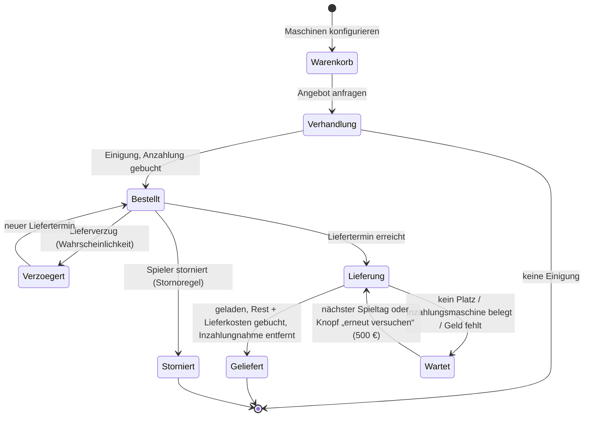

# FarmPulse – Roadmap Fahrzeughändler

Stand 15.10.2026. Ziel: Neue Maschinen kauft der Spieler beim **Landmaschinenhändler im Hof-Tablet**. Er stellt sich
die Maschine wie im Spiel-Shop zusammen (Farbe, Reifen, Motor, Ausstattung …), legt mehrere Maschinen in eine
**Sammelbestellung**, verhandelt den Preis, zahlt an, wartet die **Lieferzeit** ab und bekommt die Maschine an einen
**selbst festgelegten Lieferort** geliefert. Dazu kommen Inzahlungnahme, Stornierung, Finanzierung über die Bank und
eine Vorführmaschine. Scheitert eine Lieferung, kann der Spieler sie gegen Aufpreis sofort neu anstoßen.

Die Roadmap ergänzt [Roadmap V3](ROADMAP_V3.md) (V – Gebrauchtmaschinen) und [Roadmap V3.1](ROADMAP_V3.1.md) (A2 –
Leih- und Vorführmaschine). Die Grundentscheidungen hat der Projektinhaber am 14.10.2026 getroffen
([Entscheidungen vom 14.10.2026](#entscheidungen-vom-14102026)), alle übrigen Punkte und den Knopf „Lieferung erneut
versuchen“ am 15.10.2026 ([Entscheidungen vom 15.10.2026](#entscheidungen-vom-15102026)); beides steht auch in
`QUESTIONS.md`. **Es ist kein Punkt mehr offen**; Zahlen, die erst der Spieltest bestätigen kann, sind als Konfigwerte
markiert.

Wie V2 bis V4 enthält die Datei **nur Punkte, die mit der FS25-Schnittstelle machbar sind**. Jeder Punkt mit
Mod-Eingriff wurde am 14.10.2026 gegen den FS25-Quellcode-Dump und die Community-LUADOC geprüft (Quellen am Ende).
Was sich damit nicht belegen lässt, steht unter [Bewusst nicht aufgenommen](#bewusst-nicht-aufgenommen) oder ist als
🟡 mit Fallback markiert.

**Warum das zum Spiel passt:** Der Spiel-Shop kauft selbst über `BuyVehicleData:buy`. Diese Funktion macht nichts
anderes als FarmPulse seit den Gebrauchtmaschinen (R3-V2): Sie füllt ein `VehicleLoadingData` mit Shop-Eintrag,
**Konfigurationen**, Ladeplatz, Besitzstatus und Besitzer und ruft `load` auf. FarmPulse übergibt künftig zusätzlich
die gewählten Konfigurationen und statt des Shop-Platzes auf Wunsch eine eigene Position. Das Spiel lädt Fahrzeuge an
festen Positionen selbst so (`PlaceableVehicle`, `ReceivingHopper`, `SupportVehicle`).

**Grundsätze (unverändert aus V1–V4)**

- Der Mod bleibt **Sensor und Aktuator**: Er liest den Katalog, merkt sich Positionen und lädt Maschinen. Preise,
  Lieferzeiten, Verzug, Rabatte, Lieferkosten und Stornogebühren berechnet das Backend nach festen, konfigurierbaren
  Formeln (`rpsim.formulas.*`). Die KI formuliert nur die Mails des Händlers.
- Jeder Zugriff auf FS25 läuft in `RPSimGameAdapter` und ist mit `pcall` abgesichert. Fehlt eine API, fällt die
  Funktion still auf das bisherige Verhalten zurück (hier: Standardkonfiguration, Shop-Platz).
- Neue Felder in den Bridge-Dateien sind **optional** (`schemaVersion` bleibt `1`).
- Beträge gibt der Spieler nie im Freitext ein, sondern über Formulare. Das Backend legt jeden Preis fest.
- Anweisungen, die Geld bewegen, laufen als **Batch** (alles oder nichts) oder buchen wie `VEHICLE_SPAWN` selbst im
  Lade-Callback.
- Spielmonat = FS25-Periode. **Lieferzeiten** (und die Dauer der Vorführung) sind Tage eines 30-Tage-Monats und
  werden auf die Monatslänge des Spielstands umgerechnet, stundengenau (siehe [Zeitrechnung](#zeitrechnung-gilt-für-l1l4-l7-und-v1)).
  Fristen wie die Gültigkeit eines Angebots bleiben Spieltage wie bei Gebrauchtmaschinen.
- Ist der **Dispo** eingeschaltet (#57), dürfen alle Abbuchungen des Händlers das Konto bis zur Dispo-Grenze belasten
  (`minBalance`), wie jede andere Abbuchung von FarmPulse.

**Hängt ab von:**

- Fahrzeug-Katalog `market_context.storeVehicles[]` (R3-V1), `VEHICLE_SPAWN` / `VEHICLE_REMOVE` (R3-V2, R3-V3,
  `vehicle/VehicleTradeService`), Verhandlungs-Engine mit `AssetType.VEHICLE` (`negotiation/NegotiationEngine`),
- Leih- und Vorführmaschine mit Preis 0 (R31-A2, `farmwork/MachineLoanService`),
- eigene Maschinen `assets.vehicles[]` mit `value` (`getSellPrice()`), `name`, `xmlFilename`, `category`,
- Kontoauszug `bookings` mit Einzelbuchungen `SHOP_VEHICLE_BUY` und Fahrzeugnamen (R2-B1,
  `docs/dev/bridge-protocol.md`, Mod-Konfig `bookingLogSingleTypes`),
- Kreditantrag mit Verwendungszweck (`credit/*`, `Loan.purpose`), Liquiditätsplanung (R3-K2),
- Taste im Spiel nach dem Muster „FarmPulse: offene Frage“ (R2-F3, `RPSIM_OPEN_PROMPT` in `modDesc.xml`),
- Hinweis im Spiel (`NOTIFICATION`), Aufgaben, Kalender, Tagebuch, Charaktersystem mit Vertrauen
  (`character/ServiceRoleService`),
- Kalender `calendar.daysPerPeriod`, `monotonicDay`, `dayTimeMs` und die Umrechnung auf die Monatslänge
  (`rpsim.formulas.absence-scaling`, `employee/AbsenceScale`, #56),
- Dispo mit `minBalance` an `MONEY_TRANSACTION` und `VEHICLE_SPAWN` (#57).

## Legende

| Zeichen | Bedeutung |
| --- | --- |
| ✅ **Belegt** | Die genutzte Funktion bzw. das Feld steht so im FS25-Code; Fundstelle ist angegeben. |
| 🟡 **Im Spiel prüfen** | Die API existiert, aber ein Detail lässt sich nur im laufenden Spiel klären. Zu jedem 🟡 steht ein Fallback. |
| – | Kein Mod-Eingriff: nur Backend und Oberfläche mit Daten und Anweisungen, die es schon gibt. |

Punkt-IDs: `RFH-<Bereich><Nummer>`, z. B. `RFH-L3`. Alle Pfade sind relativ zum Repo-Root.

## Übersicht und empfohlene Reihenfolge

| Phase | Bereich | Inhalt | Mod-Eingriff | Hängt ab von |
| --- | --- | --- | --- | --- |
| 0 | [Q – Querschnitt](#q--querschnitt) | Katalog mit Konfigurationen, Lieferorte aus dem Spiel, Anweisung `VEHICLE_DELIVERY`, Buchungsgründe, Simulator, Tests, Doku (**Vertrag umgesetzt 15.10.2026**) | ja | R3-V1..V3 |
| 1 | [H – Händler](#h--der-händler) | Neue Rolle `MACHINE_DEALER`, Händler-Oberfläche (**Rolle und App-Gerüst umgesetzt 15.10.2026**) | nein | – |
| 2 | [K – Konfigurator und Sammelbestellung](#k--konfigurator-und-sammelbestellung) | Katalog durchsuchen, Maschine konfigurieren, Warenkorb (**umgesetzt 15.10.2026**; Anfrage des Angebots mit B) | nein (über Q1) | Q1, H |
| 3 | [O – Lieferorte](#o--lieferorte) | Lieferort im Spiel per Taste festlegen, benennen, verwalten; Shop-Platz als Standard (**O1 umgesetzt 15.10.2026**; O2 mit B) | ja (über Q2) | Q2 |
| 4 | [B – Angebot, Verhandlung und Bezahlung](#b--angebot-verhandlung-und-bezahlung) | Angebot, Verhandlung, Anzahlung, Finanzierung, Inzahlungnahme, Stornierung | nein | K, H |
| 5 | [L – Lieferzeit und Lieferung](#l--lieferzeit-und-lieferung) | Lieferzeit nach Monatslänge je Kategorie, Konfig-Zuschlag, Express, Verzug, Lieferung mit Platzprüfung und Ausweichen, Lieferkosten nach Entfernung, Knopf „Lieferung erneut versuchen“ | ja (über Q3) | Q3, O, B |
| 6 | [S – Spiel-Shop bleibt, der Händler merkt es](#s--spiel-shop-bleibt-der-händler-merkt-es) | Käufe im Spiel-Shop erkennen, Reaktion des Händlers | nein | H |
| 7 | [V – Vorführmaschine](#v--vorführmaschine) | Vorführung einer Katalog-Maschine vor der Bestellung | nein | H, K |

Q zuerst, weil K, O und L den neuen Vertrag brauchen. H und K können parallel laufen. L kommt nach B, weil die
Lieferung den Restbetrag bucht. S und V sind klein und unabhängig. Alle Bereiche funktionieren mit einem älteren Mod
(ohne Q) eingeschränkt: Dann gibt es nur die Standardkonfiguration und nur den Shop-Platz (die Lieferung läuft dann
über das bekannte `VEHICLE_SPAWN`).

### Ablauf einer Bestellung



---

## Entscheidungen vom 14.10.2026

| Thema | Entscheidung |
| --- | --- |
| Was heißt „verlegen“? | Der **Spiel-Shop bleibt**. FarmPulse bekommt einen eigenen Händler. Käufe im Spiel-Shop erkennt FarmPulse und der Händler reagiert im Rollenspiel (Bereich S). |
| Bezahlung | **Anzahlung** bei Bestellung, **Rest bei Lieferung** (im Lade-Callback wie bei Gebrauchtmaschinen). |
| Lieferzeit | **Spanne je Shop-Kategorie**, **Zuschlag für abweichende Konfiguration**, **Expresslieferung** gegen Aufpreis, **Lieferverzug** möglich. |
| Lieferorte | **Taste im Spiel** an der Position des Spielers; der **Shop-Platz** des Spiels bleibt immer wählbar und ist Standard. Kein Klick auf der Hofkarte. |
| Händler | **Neue Rolle** Landmaschinenhändler (`MACHINE_DEALER`), getrennt von der Werkstatt. |
| Preis | Listenpreis inkl. Konfiguration, **Verhandlung** mit der bestehenden Engine. |
| Lieferkosten | **Nach Entfernung** vom Shop-Platz zum Lieferort. |
| Extras | **Inzahlungnahme**, **Stornierung**, **Finanzierung über die Bank**, **Vorführmaschine**, **Sammelbestellung** (mehrere konfigurierte Maschinen in einer Bestellung). |
| Sammelbestellung | Der **Spieler wählt** beim Bestellen: zusammen liefern oder einzeln. |
| Kein Platz am Lieferort | **Ausweichen auf den Shop-Platz**; ist auch der voll, neuer Versuch am nächsten Spieltag (seit 15.10.2026 zusätzlich der Knopf aus L7). |
| Wert der Inzahlungnahme | **Spielwert** (`getSellPrice()`) als Grundlage, Teil der Verhandlung. |
| Übergabe der Inzahlungsmaschine | **Bei Lieferung**; bis dahin bleibt sie nutzbar. |

---

## Q – Querschnitt

Wie R3-Q, R31-Q und R4-Q legt Q **zuerst den Vertrag** an: Schemas, DTOs, Validator, Normalisierung im Mod,
Simulator und Doku. Das Auslesen im Spiel und die neue Anweisung kommen mit K, O und L.

**Stand 15.10.2026: Vertrag umgesetzt.** Im Mod: `RPSimStoreCatalog.build` und `RPSimBridge:exportStoreCatalog`
(schreibt `store_catalog.json`, sobald der Adapter die Ausstattungen liest – RFH-K1), `RPSimFarmFacts.buildDeliveryPoints`,
`RPSimMarketContext.buildStorePlaces`, die Prüfung von `VEHICLE_DELIVERY` (bis RFH-L5 `FAILED` / `NOT_SUPPORTED`) und
die fünf Buchungsgründe mit ihren Titeln. Im Backend: DTOs, Validator, das Einlesen von `store_catalog.json` an den
verknüpften Spielstand (Spalte `savegame.store_catalog_json`, `FactsService.storeCatalog`), `InstructionType.VEHICLE_DELIVERY`
mit dem Hinweis „Mod aktualisieren“, die Buchungsgründe mit ihren Klassen. Simulator: Szenario `fahrzeughaendler`,
`VEHICLE_DELIVERY` wie die geplante Mod-Aktion, `POST /delivery-point`, `/delivery-place-blocked`, `/shop-full`.
Umsetzungshinweis (kein neues Verhalten, `QUESTIONS.md` 15.10.2026): Eine Quittung trägt nur einfache Werte
(`RPSimProcessor.normalizeResult`, seit R3-Q1), deshalb meldet `VEHICLE_DELIVERY` je Maschine einen Schlüssel
`vehicleId1` … statt einer Liste. Noch offen in Q, weil es zum jeweiligen Bereich gehört: Taste und Speicherung der
Lieferorte (O1), Auslesen der Shop-Plätze (L6), die Ausführung von `VEHICLE_DELIVERY` (L5)
und die Konfigwerte `rpsim.formulas.machine-dealer.*` (mit H, K, B, L, S, V).

### RFH-Q1 Katalog mit Konfigurationen

- [x] Je Katalog-Eintrag zusätzlich (`storeVehicles[]` aus R3-V1 bleibt, die neuen Felder sind optional):
  - `brand` (Rohname der Marke, `storeItem.brandNameRaw`), `dailyUpkeep` (`storeItem.dailyUpkeep`),
    `allowLeasing` nur als Info (Leasing gibt es beim Händler nicht, siehe „Bewusst nicht aufgenommen“),
  - `isBundle` (`storeItem.bundleInfo ~= nil`: mehrere Fahrzeuge in einem Eintrag, z. B. Gespann),
  - `configurations[]` je Konfigurationstyp: `name` (z. B. `baseColor`, `wheel`, `motor`), `title` (Anzeigename
    des Typs), `options[]` je Option mit `index`, `saveId`, `name`, `desc`, `price`, `dailyUpkeep`, `isDefault`,
    `isSelectable`, `color` (nur Farbtypen: `{ r, g, b }`) und `dependent[]` (`{ name, index }`: Optionen, die
    diese Option mit festlegt),
  - `defaultConfigurations` (`storeItem.defaultConfigurationIds`),
  - `configurationSets[]` (Ausstattungspakete des Herstellers): `name`, `isDefault`, `configurations` (`name →
    index`).
- [ ] Der Listenpreis einer Zusammenstellung ist **Grundpreis + Summe der Optionspreise**. Das rechnet das Backend
  genau wie das Spiel (`StoreItemUtil.getDefaultPrice` → `getCosts(storeItem, configurations, "price")`).
- [x] Der Katalog steht in einer **eigenen Datei `store_catalog.json`**, geschrieben einmal je Spielstart
  (Entscheidung 15.10.2026). `market_context.json` bleibt dadurch klein. Ausweichlösung, falls die Datei im Spieltest
  zu groß oder zu langsam ist: Details je Maschine auf Anfrage (eine Anweisung, die Antwort in einer Datei).
- [x] Der Händler führt den ganzen Fahrzeug-Katalog (K1). Für `store_catalog.json` gilt deshalb **keine Obergrenze**
  (Entscheidung 15.10.2026); `storeCatalogMaxEntries` kürzt weiter nur `storeVehicles` aus R3-V1. Der Schalter
  `storeCatalogExport` gilt für beide.
- [x] `docs/dev/bridge-protocol.md` je Feld mit Quelle im FS25-Code.

**Beleg:**

- ✅ `Shop/StoreManager.md` (LUADOC), `loadItem`: Für `species == VEHICLE` lädt das Spiel beim Laden des Shops
  `storeItem.configurations`, `storeItem.defaultConfigurationIds` (`ConfigurationUtil.getConfigurationsFromXML`),
  `storeItem.subConfigurations` und `storeItem.configurationSets`. Dazu `price`, `dailyUpkeep`, `lifetime`,
  `brandIndex`, `brandNameRaw`, `allowLeasing`, `categoryName`. Bei Bundles werden die Optionspreise der Einzelteile
  addiert.
- ✅ `configurations/ConfigurationUtil.lua` (Dump): `getConfigurationsFromXML` (Optionen je Typ, Reihenfolge =
  `index`), `getDefaultConfigIdFromItems` (Standard = erste Option mit `isDefault` und `isSelectable`, sonst erste
  wählbare), `getConfigurationSetsFromXML` (Pakete mit `name`, `isDefault`, `configurations`),
  `getConfigIdBySaveId` / `getSaveIdByConfigId`, `getColorByConfigId`.
- ✅ `Configurations/VehicleConfigurationItem.md` (LUADOC), `new` / `loadFromXML`: Felder `name`, `desc`, `price`,
  `dailyUpkeep`, `isDefault`, `isSelectable`, `saveId`, `isYesNoOption`, `overwrittenTitle`.
- ✅ `Configurations/VehicleConfigurationItemColor.md`: `getColor()` liefert `{ r, g, b }`.
- ✅ `VehicleLoadingData.lua` (Dump), `getConfigurations`: `configItem.dependentConfigurations` (`{ name, index }`)
  setzt abhängige Optionen.
- ✅ `Utils/StoreItemUtil.md`: `getCosts`, `getDefaultPrice`, `getDailyUpkeep`, `getIsConfigurable`.

**🟡 Im Spiel prüfen:**

- Unter welchem Feld steht der **Anzeigename eines Konfigurationstyps**? Er wird als zweites Argument von
  `addConfigurationType(name, title, …)` übergeben (z. B. `Specializations/WorkMode.md`), der Rumpf von
  `addConfigurationType` fehlt aber im Dump. **Fallback:** Die Oberfläche zeigt den technischen Namen über eine
  Übersetzungstabelle im Frontend (`baseColor` → „Farbe“ …), unbekannte Typen mit ihrem Namen.
- Weicht der Preis im Spiel-Shop vom Listenpreis ab? Der Shop rechnet mit `EconomyManager:getBuyPrice(storeItem,
  configurations, saleItem)` (`Shop/BuyVehicleData.md`, `updatePrice`), dessen Rumpf in keiner Quelle steht.
  **Fallback:** FarmPulse nennt den Preis „Listenpreis laut Shop-Daten“ (`getDefaultPrice`).
- Wie groß und wie langsam ist der Export aller Konfigurationen? **Fallback:** Details je Maschine auf Anfrage (siehe
  oben).

### RFH-Q2 Lieferorte aus dem Spiel

- [x] Neue Taste **„FarmPulse: Lieferort hier festlegen“** (Aktion `RPSIM_SET_DELIVERY_POINT` in `modDesc.xml`,
  Kategorie `ONFOOT`, in der Steuerung änderbar). Registriert wie `RPSIM_OPEN_PROMPT`. Standardbelegung **Alt+L**
  (Entscheidung 15.10.2026; ob frei: Testplan 31.5); englische Texte „FarmPulse: set delivery point here“, „Delivery
  point saved – name it in the farm tablet“, „Delivery points only on own or leased land“ (Entscheidung 15.10.2026).
- [x] Beim Druck merkt sich der Mod: Position des Spielers (`x`, `y`, `z`), Blickrichtung als Drehung um die
  Hochachse (`ry`), das Flurstück an der Stelle (`farmlandId`) und Spieltag/Uhrzeit. Hinweis im Spiel: „Lieferort
  gespeichert – im Hof-Tablet benennen“.
- [x] **Nur auf eigenem oder gepachtetem Land** (Entscheidung 15.10.2026): Gehört das Flurstück an der Stelle nicht der
  Spieler-Farm (`g_farmlandManager:getFarmlandOwner(farmlandId) ~= farmId`), speichert der Mod nichts und zeigt
  „Lieferort nur auf eigenem oder gepachtetem Land“.
- [x] `farm_facts.json`, neuer optionaler Block `deliveryPoints[]` = `{ seq, x, y, z, ry, farmlandId, day, dayTimeMs }`
  (Vertrag; die Speicherung im Mod-Spielstand kommt mit der Taste, RFH-O1):
  die letzten **20** festgelegten Punkte (Mod-Einstellung `deliveryPointsMax`, Entscheidung 15.10.2026), fortlaufend
  nummeriert (`seq`). Der Mod speichert sie im
  Mod-Spielstand (`FS25_RPSim.xml`, `RPSimPersistence`). Das Backend übernimmt jeden neuen `seq` einmal; Name und
  Verwaltung liegen danach nur im Backend (O1).
- [x] `market_context.json`, neuer optionaler Block `storePlaces[]` = `{ x, z }`: Mittelpunkt jedes Shop-Platzes, nur für
  die Lieferkosten nach Entfernung (L6).

**Beleg:**

- ✅ `VehicleSystem.lua` (Dump), `consoleCommandLoadAllVehiclesNext`: `g_localPlayer:getPosition()` und
  `g_localPlayer:getCurrentFacingDirection()` (liefert `dirX, dirZ`), danach `VehicleLoadingData:setPosition`.
- ✅ `VehicleLoadingData.lua` (Dump), `setLoadingPlace`: `MathUtil.getYRotationFromDirection(dirX, dirZ)` macht aus
  einer Richtung die Drehung `ry`.
- ✅ `Economy/FarmlandManager.md` (LUADOC): `g_farmlandManager:getFarmlandIdAtWorldPosition(x, z)` (im Mod seit
  R31-D5 genutzt).
- ✅ Taste: Muster von R2-F3 (`RPSim.lua`, `g_inputBinding:registerActionEvent`, `modDesc.xml` `<actions>` /
  `<inputBinding>`).
- 🟡 `storePlaces[]`: `g_currentMission.storeSpawnPlaces` ist belegt (`Missions/AbstractMission.md`), der Aufbau eines
  Platzes nur indirekt: `PlacementUtil.loadPlaceFromXML` liefert in `PalletSpawner` Plätze mit `startX`, `startY`,
  `startZ`, `dirX`, `dirZ`, `width` (`Placement/PalletSpawner.md`); `PlacementUtil` selbst steht in keiner Quelle.
  **Fallback:** ohne `storePlaces` gibt es nur die Grundpauschale der Lieferkosten (L6).

**🟡 Im Spiel prüfen:**

- Liefert `g_localPlayer:getPosition()` die Füße (Boden) oder die Augenhöhe? **Fallback:** Bei der Lieferung wird `y`
  immer neu aus dem Gelände genommen (`setPosition(x, nil, z)` → `getTerrainHeightAtWorldPos`), gespeichert wird `y`
  nur zur Info.
- Welche Standardbelegung der Taste ist frei? **Fallback:** keine Standardbelegung, der Spieler belegt sie in der
  Steuerung selbst.

### RFH-Q3 Neue Anweisung `VEHICLE_DELIVERY`

`VEHICLE_SPAWN` (R3-V2) bleibt für Gebraucht-, Leih- und Vorführmaschinen unverändert. Die Lieferung einer
Neumaschine braucht Konfigurationen, mehrere Maschinen, eine eigene Position, Inzahlungnahmen und eine Buchung erst
nach dem Laden. Dafür kommt eine eigene Anweisung:

```json
{ "type": "VEHICLE_DELIVERY", "deliveryId": "…",
  "items": [ { "storeXmlFilename": "…", "configurations": { "baseColor": { "saveId": "…", "index": 3 } } } ],
  "place": { "x": 12.5, "z": -340.0, "ry": 1.57 },
  "fallbackToShop": true,
  "bookings": [ { "amount": 98000, "moneyReason": "VEHICLE_NEW_PURCHASE", "note": "…" },
                { "amount": 850, "moneyReason": "VEHICLE_DELIVERY_FEE", "note": "Lieferung" },
                { "amount": 500, "moneyReason": "VEHICLE_DELIVERY_FEE", "note": "Neuer Lieferversuch" } ],
  "minBalance": 0,
  "tradeIns": [ "<vehicleId>" ] }
```

- [x] Ablauf im Mod (umgesetzt 16.10.2026, `RPSimGameAdapter:deliverVehicles` / `onDeliveryLoaded`):
  1. **Inzahlungnahmen prüfen** wie `VEHICLE_REMOVE` (R3-V3): eigene Maschine, `OWNED`, niemand drin, kein Helfer,
     nichts angehängt. Sonst `FAILED` mit dem Code von R3-V3, **nichts** wird geladen oder gebucht.
  2. **Guthaben prüfen** gegen die Summe der `bookings` (wie `VEHICLE_SPAWN`; mit Dispo bis `minBalance`).
  3. Je Position den Shop-Eintrag holen und die Konfiguration umsetzen: `saveId` → Index über
     `ConfigurationUtil.getConfigIdBySaveId`, sonst `index`; unbekannte Optionen → Standard des Spiels.
  4. **Platz am Lieferort prüfen** (wenn `place` gesetzt): Größe je Maschine mit
     `StoreItemUtil.getSizeValues(xmlFilename, "vehicle", ry, configurations)`, mehrere Maschinen nebeneinander quer zur
     Blickrichtung, je Maschine `overlapBox` auf Fahrzeuge, bewegliche Objekte und Gebäude. Ist eine Stelle belegt
     und `fallbackToShop` an, gehen **alle** Maschinen der Lieferung auf die Shop-Plätze
     (`setLoadingPlace(g_currentMission.storeSpawnPlaces, g_currentMission.usedStorePlaces)`); ist auch dort kein
     Platz, `FAILED` mit `NO_SPACE`.
  5. Laden: `VehicleLoadingData.new()`, `setStoreItem`, `setConfigurations`, `setBoughtConfigurations` (gewählte
     Optionen als gekauft), am Lieferort `setPosition(x, nil, z)` + `setRotation(0, ry, 0)`, sonst `setLoadingPlace`,
     `setPropertyState(OWNED)`, `setOwnerFarmId`, `load(callback)`.
  6. Im Callback, wenn **alle** Maschinen geladen sind: Inzahlungnahmen erneut prüfen und mit `vehicle:delete()`
     entfernen, dann die `bookings` der Reihe nach abbuchen (Rest `VEHICLE_NEW_PURCHASE`, Lieferkosten und Aufpreis für
     einen neuen Versuch `VEHICLE_DELIVERY_FEE`, Express `VEHICLE_EXPRESS_FEE`). Schlägt etwas fehl, werden die
     geladenen Maschinen wieder gelöscht (wie `onVehicleSpawned` heute) und nichts gebucht.
  7. Quittung mit `result = { placeUsed: "DELIVERY_POINT" | "SHOP", vehicleCount, vehicleId1 … vehicleIdN,
     tradeInsRemoved }`: eine Quittung trägt nur einfache Werte (`RPSimProcessor.normalizeResult`, seit R3-Q1), deshalb
     je geladener Maschine ein eigener Schlüssel in der Reihenfolge der Positionen.
- [x] Bis zur Quittung bleibt die Anweisung offen (keine Quittung, nicht im Spielstand), wie `VEHICLE_SPAWN`. Nach einem
  Neuladen ohne Speichern sendet das Backend sie erneut; `processedInstructions` verhindert eine doppelte
  Ausführung.
- [x] `bookings` statt eines einzelnen `price`, weil eine Lieferung mehrere Buchungsgründe trägt; jede Buchung
  erscheint einzeln im Kontoauszug.
- [x] Fehlercodes: `NO_SPACE`, `UNKNOWN_STORE_ITEM`, `INSUFFICIENT_FUNDS`, `LOAD_FAILED`, dazu die Codes von
  `VEHICLE_REMOVE` mit dem Zusatz der Inzahlungsmaschine (`TRADE_IN_NOT_FOUND`, `TRADE_IN_IN_USE`,
  `TRADE_IN_ATTACHED`, `TRADE_IN_NOT_OWN`). Seit 16.10.2026 folgt diesen Codes die `uniqueId` der Maschine
  (`TRADE_IN_ATTACHED: veh_00007`), damit das Tablet „<Name> ist angekoppelt“ nennen kann.
- [x] Ein Mod ohne Q3 lehnt den Typ ab (`REJECTED`, „unknown type …“) bzw. ein Mod mit Q, aber ohne L5 quittiert
  `NOT_SUPPORTED`. **Entscheidung 16.10.2026: kein Rückfall auf `VEHICLE_SPAWN`.** Die Lieferung wartet beim Händler
  wie bei jedem anderen Fehlschlag; der Grund im Tablet heißt „Mod aktualisieren“, die Meldung trägt `modOutdated`
  wie seit R3-Q1 (vorher vorgeschlagen: `VEHICLE_SPAWN` je Maschine ohne Konfiguration und ohne Lieferort).

**Beleg:**

- ✅ `Shop/BuyVehicleData.md` (LUADOC), `buy`: Der Spiel-Shop kauft mit `VehicleLoadingData.new()`,
  `setStoreItem`, `setConfigurations(configurations, boughtConfigurations)`, `setConfigurationData`,
  `setLoadingPlace(storePlaces, usedStorePlaces)`, `setPropertyState(OWNED | LEASED)`, `setOwnerFarmId`, `load`.
  `setConfigurations` trägt jede gewählte Option auch als gekauft ein.
- ✅ `VehicleLoadingData.lua` (Dump):
  - `setPosition(x, y, z, terrainOffset)`: ohne `y` nimmt es die Geländehöhe (`getTerrainHeightAtWorldPos`),
  - `setRotation(rx, ry, rz)`, `setConfigurations`, `setBoughtConfigurations`, `setStoreItem` (Bundles: mehrere
    Fahrzeuge mit Versatz),
  - `setLoadingPlace` misst die Maschine mit `StoreItemUtil.getSizeValues(xmlFilename, "vehicle", yRot,
    configurations)` und gibt `false` zurück, wenn kein Platz frei ist.
- ✅ Laden an einer festen Position ohne Shop-Platz macht das Spiel selbst: `Specializations/PlaceableVehicle.md`
  (`setPosition` + `setRotation` am Verknüpfungsknoten), `ReceivingHopper.md`, `SupportVehicle.md`.
- ✅ `Vehicle.lua` (Dump): Ohne `setLoadingPlace` bleibt `validLocation = true`, `applyPositionData` prüft dann
  **keinen** Platz (Ladezustand `NO_SPACE` nur bei `validLocation == false`). Deshalb prüft der Mod selbst mit
  `overlapBox`.
- ✅ `engine/Physics/overlapBox.md` (LUADOC): `overlapBox(x, y, z, rx, ry, rz, ex, ey, ez, callback, target,
  collisionMask, includeDynamics, includeKinematics, includeStatics, exactTest)` liefert die Zahl der getroffenen
  Körper. Das Spiel prüft so Paletten-Plätze (`Placement/PalletSpawner.md`, `CollisionFlag.VEHICLE +
  CollisionFlag.DYNAMIC_OBJECT`).
- ✅ `Vehicle.lua` (Dump): Ein neu geladenes Fahrzeug hat `age = 0`; `price` kommt aus `vehicleLoadingData.price`
  oder, wenn leer, aus `StoreItemUtil.getDefaultPrice(storeItem, configurations)`. `BuyVehicleData:buy` setzt keinen
  Preis am `VehicleLoadingData`, das Spiel nimmt also auch beim Shop-Kauf den Listenpreis inkl. Konfiguration als
  Fahrzeugpreis. FarmPulse macht es genauso; der Wiederverkaufswert (`calculateSellPrice`) hängt nicht vom
  ausgehandelten Preis ab.
- ✅ Inzahlungnahme: wie R3-V3 (`VehicleSystem:getVehicleByUniqueId`, `Vehicle:delete`, `getIsControlled`,
  `getIsAIActive`, `getRootVehicle`).

**🟡 Im Spiel prüfen:**

- Steht die Maschine bei `setPosition` mittig auf dem Punkt, und stimmt die Ausrichtung? Der Rumpf von
  `getPositionAndRotation` (Shop-Versatz, Zentrierung) fehlt im Dump. **Fallback:** `setIgnoreShopOffset(true)` und
  ein fester Abstand vor dem Spieler (wie der Konsolenbefehl: 10 m in Blickrichtung).
- Welche Kollisionsmaske erkennt Gebäude, Zäune und den Spieler zuverlässig? **Fallback:** `overlapBox` mit allen Bits
  (Standard der Funktion) und `includeStatics = true`; im Zweifel gilt der Platz als belegt und es wird auf den
  Shop-Platz ausgewichen.
- Wird eine gewählte Konfiguration im Fahrzeugmenü des Spiels richtig angezeigt (Farbe, Reifen, Motor)?
  **Fallback:** keiner nötig – das ist derselbe Weg wie im Spiel-Shop; bei Abweichung wird der Fall als Fehler
  dokumentiert.
- Bundles mit eigener Position: Halten die Einzelteile ihren Versatz zueinander? **Fallback:** Bundles immer auf den
  Shop-Platz.

### RFH-Q4 Buchungsgründe und Konfiguration

- [x] Neue `MoneyReason`-Werte in Mod, Backend und `modDesc.xml` (`rpsim_money_<REASON>`), Entscheidung 15.10.2026:

  | Grund | Wofür | Klasse (`rpsim.formulas.finance.categories`) |
  | --- | --- | --- |
  | `VEHICLE_DEPOSIT` | Anzahlung bei Bestellung | Investition |
  | `VEHICLE_NEW_PURCHASE` | Rest bei Lieferung, Titel „Maschinenkauf (neu)“ (Entscheidung 15.10.2026: eigener Grund, weil `VEHICLE_PURCHASE` „Maschinenkauf (gebraucht)“ heißt) | Investition |
  | `VEHICLE_DELIVERY_FEE` | Lieferkosten und Aufpreis für einen neuen Lieferversuch | Investition |
  | `VEHICLE_EXPRESS_FEE` | Expresszuschlag | Investition |
  | `VEHICLE_REFUND` | Rückzahlung der Anzahlung bei Stornierung | Desinvestition |
  | `VEHICLE_CANCELLATION_FEE` | einbehaltener Teil der Anzahlung | operative Ausgabe |

  Ein älterer Mod lehnt einen unbekannten Grund ab (wie bei jedem neuen Grund seit R3-Q1); der Vorgang wird dann
  storniert und das Tablet sagt „Mod aktualisieren“.
- [ ] Alle Werte unter `rpsim.formulas.machine-dealer.*` in `application.yml` und `RpsimProperties.java`
  (Anzahlung, Rabatt, Spannen, Zuschläge, Express, Verzug, Lieferkosten, Aufpreis neuer Versuch, Storno, Vertrauen,
  Klatsch-Grenze, Vorführung, Positionen je Bestellung).
  **Achtung:** `ConfigurationReferenceDocTest` schlägt fehl, wenn ein Schlüssel in
  `docs/dev/configuration-reference.md` fehlt.

**Beleg:** – (wie R3-Q1: `MoneyType.register`, Texte in `modDesc.xml`).

### RFH-Q5 Simulator, Tests, Doku

- [x] `tools/bridge-simulator`: neues Szenario `fahrzeughaendler` mit Katalog inkl. Konfigurationen, zwei
  Lieferpunkten und Shop-Plätzen; der Simulator führt `VEHICLE_DELIVERY` aus wie der spätere Mod, ein Endpunkt
  `POST /delivery-point` simuliert den Tastendruck (auch auf fremdem Land), ein Schalter belegt den Lieferort bzw.
  den Shop-Platz (Ausweichen, Warten und „erneut versuchen“ testen).
- [x] Mod-Tests (`mod/tests/test_machine_dealer.lua`) mit gemockten FS25-Globals: Konfigurationen exportieren,
  `saveId` → Index, Lieferpunkt speichern und laden, `overlapBox` frei/belegt, Ausweichen, Inzahlungnahme belegt,
  Buchung erst im Callback, Löschen bei Fehlschlag.
- [ ] Backend (Vertrag erledigt: `MachineDealerContractTest`, `BridgeSyncIntegrationTest`, `FailedInstructionTest`,
  End-to-End gegen den Simulator; die Formeln folgen mit ihren Bereichen): Grenzwert-Tests für jede Formel (Lieferzeit bei 1, 3 und 30 Spieltagen je Monat, 9-Uhr-Regel, Verzug,
  Express, Lieferkosten, Stornogebühr, Rabatt-Grenze, Aufpreis neuer Versuch), End-to-End-Test gegen den Simulator.
- [x] `docs/dev/manual-test-plan.md`: neuer Abschnitt mit je einer Zeile pro 🟡 dieser Roadmap.
- [x] `docs/dev/bridge-protocol.md`, `mod/README.md`, `CHANGELOG.md`, `docs/dev/testing.md`;
  `docs/user-guide/funktionen.md` folgt mit der ersten sichtbaren Funktion (H, K).

**Beleg:** –.

**Akzeptanz Q:** Der Katalog zeigt zu einer Maschine alle Optionen mit Preis wie der Spiel-Shop. Ein Tastendruck im
Spiel erscheint als neuer Lieferpunkt im Backend. Eine `VEHICLE_DELIVERY` mit zwei konfigurierten Maschinen landet am
Lieferpunkt, bei belegtem Punkt auf dem Shop-Platz, ohne Platz gar nicht – und gebucht wird nur bei Erfolg.

---

## H – Der Händler

**Stand 15.10.2026: Rolle und App-Gerüst umgesetzt.** Rolle `CharacterRole.MACHINE_DEALER` mit Pool-Texten
(Titel „Landmaschinenhändler/in“, Beschreibung „verkauft neue Landmaschinen nach Wunsch ausgestattet und liefert sie auf
den Hof“, Kontakte „Landmaschinenhändler:in“). Entscheidung 15.10.2026: Der Händler gehört in neuen Spielständen zur
**Startbesetzung** des Onboardings (`OnboardingService.MANDATORY_ROLES`); ältere Spielstände bekommen ihn beim ersten
Öffnen der App über `POST /api/dealer/open` (`dealer/MachineDealerService.open` → `ServiceRoleService.ensure`, Vorstellung
per Mail und Tagebuch). `GET /api/dealer` liest nur. Die App „Händler“ (`/haendler`, Symbol `tractor`, Untertitel „Neue
Maschinen ausstatten, bestellen und liefern lassen“, Hinweis beim ersten Öffnen) hat die vier Tabs; bis K, O, B und L
zeigt jeder Tab den Händler als Kontakt (Rolle, Name mit Link zum Profil, Vertrauensstufe) und den Hinweis „Folgt mit dem
nächsten Ausbau“ (Entscheidung 15.10.2026). Noch offen in H, weil es zum jeweiligen Bereich gehört: die Mails zu Angebot,
Bestellung, Verzug, Lieferung, Platzproblem und Stornierung (B, L), Spiel-Shop-Kauf (S) und Vorführung (V), der Inhalt der
Tabs (K, O, B, L) und die Startbildschirm-Kachel (mit B/L).

### RFH-H1 Neue Rolle Landmaschinenhändler

- [x] Neue Pflichtrolle `CharacterRole.MACHINE_DEALER` (Entscheidung 14.10.2026) als Dienstleister-Rolle wie die
  Werkstatt: Name, Persönlichkeit, Gedächtnis, Vertrauen. In neuen Spielständen gehört sie zur Startbesetzung
  (Entscheidung 15.10.2026); in älteren Spielständen entsteht sie über `character/ServiceRoleService.ensure(sg, role)`
  beim ersten Anlass (erstes Öffnen des Händlers ✅ 15.10.2026, erster Spiel-Shop-Kauf mit S) und stellt sich wie ein
  neuer Dorfbewohner vor (Mail, Tagebuch).
- [ ] Der Händler schreibt Mails zu Angebot, Bestellbestätigung, Verzug, Lieferung, Platzproblem, Stornierung,
  Spiel-Shop-Kauf (S) und Vorführung (V). Alle Zahlen kommen aus dem Backend, die KI formuliert nur; ohne KI gibt es
  Texte aus `fallback-templates`.
- [ ] Die Werkstatt (`WORKSHOP`) bleibt für Reparatur, Wartung, Gebrauchtmaschinen (R3-V2) und ihre eigene
  Vorführung (R31-A2) zuständig.

**Beleg:** – (Charaktersystem seit V1, `ServiceRoleService`).

### RFH-H2 Händler-Oberfläche

- [x] Eigene App **„Händler“** direkt nach „Werkstatt“ (Entscheidung 15.10.2026), Ton `farm`, mit den Tabs
  **Katalog** (mit Konfigurator), **Warenkorb**, **Bestellungen** (Status, Liefertermin mit Uhrzeit, Zahlungen,
  Storno, „Lieferung erneut versuchen“) und **Lieferorte**. Eintrag in `frontend/src/app/layout/apps.ts`. Umgesetzt
  15.10.2026 als Gerüst: die Tabs stehen, ihren Inhalt bringen K, O, B und L.
- [ ] Startbildschirm: Kachel **„Nächste Lieferung: <Maschine> am <Tag>, <Uhrzeit>“**, solange eine Bestellung offen
  ist (Entscheidung 15.10.2026).

**Beleg:** – (Oberfläche).

**Akzeptanz H:** Der Händler steht in den Kontakten, hat ein Vertrauen wie jede Rolle, und seine App zeigt Katalog,
Warenkorb, Bestellungen und Lieferorte; mit offener Bestellung steht die Kachel auf dem Startbildschirm.

---

## K – Konfigurator und Sammelbestellung

**Stand 15.10.2026: umgesetzt** (Entscheidungen 15.10.2026, `QUESTIONS.md`). Im Mod liest
`RPSimGameAdapter:collectStoreCatalogDetails` jede Shop-Maschine mit allen Ausstattungen, den Anzeigenamen von Marke und
Kategorie und der Leistung (PS) aus; `store_catalog.json` wird damit geschrieben. Im Backend: `MachineCatalogService`
(Liste mit Filtern, Sortierung, 50 je Seite), `MachineConfigurator` (Konfiguration, Listenpreis, Tageskosten, Paket,
„legt auch fest“), `DeliveryTime` (voraussichtliche Lieferzeit nach L1–L3), `DealerCartService` (Warenkorb, Tabelle
`dealer_cart_item`, Migration V51), Konfig `rpsim.formulas.machine-dealer.*`, Endpunkte `/api/dealer/catalog`,
`/api/dealer/catalog/item`, `/api/dealer/configure`, `/api/dealer/cart`. In der App „Händler“ die Tabs **Katalog** (mit
Konfigurator) und **Warenkorb**. Die Anfrage des Angebots mit der Wahl „zusammen“ / „einzeln“ kommt mit B
(Entscheidung 15.10.2026); die Lieferkosten im Konfigurator kommen mit O und L6.

Umsetzungshinweise (kein neues Verhalten, `QUESTIONS.md` 15.10.2026): Für den Zuschlag L2 zählt von den Standards
(Standard des Spiels oder ein Paket des Herstellers) der mit den wenigsten Zusatztagen; Optionen, die eine andere Option
mitsetzt (`dependent`), sind nicht gewählt und verlängern nichts. Der Listenpreis zählt die mitgesetzten Optionen mit
(die Maschine, wie sie geliefert wird).

### RFH-K1 Katalog durchsuchen

- [x] Liste aus dem Katalog (Q1): Kategorie, Marke, Name, Grundpreis, Leistung, Tageskosten, „Mod“-Kennzeichen. Filter
  nach Kategorie, Marke, Preisspanne, Suche nach Name. Entscheidungen 15.10.2026: Anzeigenamen von Marke und Kategorie
  aus dem Spiel (`brandTitle`, `categoryTitle`) und die Leistung als Spanne in PS (`powerMin`, `powerMax`, je
  Motor-Option `power`) kommen neu in die Katalog-Datei; sortiert nach Kategorie, dann Name (Name, Grundpreis, Leistung
  per Klick), 50 Einträge je Seite.
- [x] Der Händler führt den **ganzen** Fahrzeug-Katalog des Shops, auch Paletten, Ballen, Big Bags und
  Mod-Fahrzeuge (Entscheidung 15.10.2026).

**Beleg:** ✅ R3-V1, Q1. ✅ Anzeigenamen: `Shop/BrandManager.md` (`addBrand`: `brand.title`, `$l10n_` übersetzt),
`Shop/StoreManager.md` (`addCategory`: `category.title`, über `g_i18n:convertText`). ✅ Leistung:
`Specializations/Motorized.md` (`getSpecValuePower` mit `returnValues`: kleinste/größte Leistung der wählbaren
Motor-Optionen, sonst `storeItem.specs.power`); PS: `Configurations/VehicleConfigurationItemMotor.md` liest `#hp`.
✅ `Specializations/MultipleItemPurchase.md` (LUADOC): Einträge mit `multipleItemPurchase`
(Ballen, Paletten) sind selbst ein Fahrzeug, das beim Laden die eigentlichen Ballen bzw. Fahrzeuge an seiner Position
erzeugt (`loadItemAtPosition`, `VehicleLoadingData` mit `setPosition`) und danach entfernt wird.

**🟡 Im Spiel prüfen:** Erscheinen Ballen und Paletten über `VEHICLE_DELIVERY` an einem eigenen Lieferort richtig
(Anzahl, Lage)? **Fallback:** Einträge mit `multipleItemPurchase` gehen immer auf den Shop-Platz.

### RFH-K2 Maschine konfigurieren

- [x] Je Konfigurationstyp eine Auswahl mit allen Optionen, deren Aufpreis und Tageskosten; nicht wählbare Optionen
  (`isSelectable = false`) erscheinen nicht. Vorbelegt ist die Standardkonfiguration des Spiels
  (`defaultConfigurations`). Name des Typs (Entscheidung 15.10.2026): Titel aus der Fahrzeug-XML → Titel des Spiels
  (🟡) → Tabelle im Tablet (`baseColor` „Farbe“, `designColor` „Designfarbe“, `rimColor` „Felgenfarbe“, `wheel`
  „Bereifung“, `motor` „Motor“, `design` „Design“, `vehicleType` „Ausführung“, `fillUnit` „Volumen“,
  `multipleItemPurchaseAmount` „Menge“) → technischer Name.
- [x] Farben als Farbfelder (`color`). Ja/Nein-Optionen (`isYesNoOption`) bleiben bis zur Prüfung im Spiel eine Auswahl
  mit den Optionsnamen des Spiels (Entscheidung 15.10.2026; welche Option „Ja“ ist, steht in keiner Quelle –
  Testplan 31.14); der Schalter kommt danach.
- [x] Abhängige Optionen (`dependent[]`) werden sofort mitgesetzt und angezeigt („legt auch fest: …“).
- [x] Ausstattungspakete (`configurationSets`): Das Paket, zu dem die Auswahl passt, steht beim Konfigurator, sonst
  „individuell“ (`ConfigurationUtil.getConfigurationsMatchConfigSets`).
- [x] Laufend sichtbar: Listenpreis (Grundpreis + Optionen), Tageskosten, **voraussichtliche Lieferzeit** (L1, L2) mit
  und ohne Express (L3) (Entscheidung 15.10.2026: schon mit K, „2–4 Spieltage“, unter einem Tag in Stunden, am
  frühesten Termin „frühestens morgen 9 Uhr“) und der Hinweis „Lieferkosten folgen mit den Lieferorten.“
- [ ] Lieferkosten (L6), sobald ein Lieferort gewählt ist – mit O und L6.

**Beleg:** ✅ Q1 (`getDefaultConfigIdFromItems`, `dependentConfigurations`, `getConfigurationSetsFromXML`,
`getColor`, `getCosts`).

### RFH-K3 Warenkorb und Sammelbestellung

- [x] Eine konfigurierte Maschine kommt in den Warenkorb; der Warenkorb hält **bis zu 10 Positionen** (Entscheidung
  15.10.2026, Konfig `max-positions: 10`), auch dieselbe Maschine mehrfach mit anderer Konfiguration. Gespeichert je
  Spielstand im Backend (Entscheidung 15.10.2026); je Position Name, abweichende Optionen, Listenpreis, Lieferzeit,
  „Ändern“ und „Entfernen“.
- [ ] Beim Anfragen des Angebots wählt der Spieler (Entscheidung 14.10.2026):
  - **zusammen liefern:** ein Liefertermin für alle (die längste Lieferzeit der Positionen), ein Lieferort, einmal
    Lieferkosten, eine `VEHICLE_DELIVERY` mit allen Positionen;
  - **einzeln liefern:** jede Position mit eigenem Termin, eigenem Lieferort und eigenen Lieferkosten, je eine
    `VEHICLE_DELIVERY`.
- [ ] Verhandelt wird die **ganze Bestellung** auf einmal (B2).

**Beleg:** – (Backend und Oberfläche); Lieferung mehrerer Maschinen: ✅ Q3.

**Akzeptanz K:** Eine Maschine lässt sich mit anderer Farbe und anderen Reifen zusammenstellen; der Preis stimmt mit
der Summe der Optionspreise überein. Drei Maschinen liegen im Warenkorb und werden als eine Bestellung angefragt –
einmal „zusammen“, einmal „einzeln“. Eine elfte Position lässt der Warenkorb nicht zu.

---

## O – Lieferorte

**Stand 15.10.2026: O1 umgesetzt** (Entscheidungen 15.10.2026, `QUESTIONS.md`). Im Mod die Taste (Alt+L,
`RPSimBridge:setDeliveryPointHere`, `RPSimGameAdapter:readPlayerPlace`, Mod-Einstellung `deliveryPointsMax`, Speicherung im
Mod-Spielstand). Im Backend `DeliveryPointService` (Tabelle `dealer_delivery_point`, Migration V52, Spalte
`savegame.dealer_default_point_id`) und die Endpunkte `/api/dealer/delivery-points`. Im Tablet der Tab **Lieferorte**.
O2 (Lieferort in der Bestellung) kommt mit den Bestellungen (B).

### RFH-O1 Lieferort festlegen und verwalten

- [x] Im Spiel: Der Spieler geht zu Fuß an die gewünschte Stelle, schaut in die Richtung, in die die Maschine zeigen
  soll, und drückt die Taste (Q2). Im Tablet erscheint der neue Punkt unter **Lieferorte** mit der Bitte um einen
  Namen („Maschinenhalle“, „Hof Nord“ …) und dem Flurstück.
- [x] Lieferorte gibt es **nur auf eigenem oder gepachtetem Land** (Entscheidung 15.10.2026). Steht der Spieler auf
  fremdem Land, speichert der Mod nichts und zeigt den Hinweis „Lieferort nur auf eigenem oder gepachtetem Land“.
  Gepachtete Flurstücke gehören während der Pacht auch im Spiel dem Spieler (`FARMLAND_TRANSFER` bei Beginn und Ende
  der Pacht), die Prüfung im Mod deckt beide Fälle ab.
- [x] Verwalten: umbenennen (höchstens 40 Zeichen), löschen, **Standard-Lieferort** festlegen. Der **Shop-Platz des
  Spiels** steht immer oben in der Liste, kann nicht gelöscht werden und ist Standard, solange nichts anderes gewählt ist
  (Entscheidung 14.10.2026). Wird der Standard-Lieferort gelöscht oder ungültig, ist der Shop-Platz **dauerhaft** wieder
  Standard (Entscheidung 15.10.2026).
- [x] Gehört das Flurstück eines Lieferorts nicht mehr dem Spieler (Feld verkauft, Pacht vorbei), markiert das Tablet
  den Lieferort als **ungültig**; kommt das Flurstück zurück, ist er wieder gültig (Entscheidung 15.10.2026). Das
  Backend erkennt es an den eigenen Flurstücken in `farm_facts`. Die Lieferung dorthin auf den Shop-Platz mit Hinweis
  in Mail und Tablet kommt mit L5.
- [x] Die Lieferorte gehören zum Spielstand (gleicher Schlüssel wie die übrigen Spielstand-Daten des Backends).

**Beleg:** ✅ Q2; ✅ `Economy/FarmlandManager.md`: `getFarmlandOwner(farmlandId)` (im Mod seit V1 für die eigenen
Flurstücke genutzt, `GameAdapter.lua`); Pacht über `FARMLAND_TRANSFER` (R3-L, `mod/README.md`).

### RFH-O2 Lieferort in der Bestellung

- [ ] Bei jeder Bestellung (bzw. bei „einzeln liefern“ je Position) wählt der Spieler den Lieferort; vorbelegt ist
  der Standard. Bis zum Liefertermin kann er ihn ändern; die Lieferkosten werden dann neu berechnet und mit dem Rest
  bei der Lieferung verrechnet.

**Beleg:** –.

**Akzeptanz O:** Ein im Spiel auf eigenem Land festgelegter Punkt erscheint im Tablet, lässt sich benennen und als
Standard setzen; auf fremdem Land kommt nur der Hinweis. Der Shop-Platz ist immer wählbar. Nach dem Verkauf des Feldes
ist der Lieferort ungültig und die Lieferung geht auf den Shop-Platz.

---

## B – Angebot, Verhandlung und Bezahlung

### RFH-B1 Angebot

- [ ] Aus dem Warenkorb fragt der Spieler ein **Angebot** an. Der Händler antwortet **am nächsten Spieltag**; das
  Angebot gilt **7 Spieltage** (Entscheidung 15.10.2026, wie Gebrauchtmaschinen). Es nennt: Listenpreis je Position
  (inkl. Optionen), Lieferzeit je Position (L1–L2), Expressoption mit Aufpreis (L3), Lieferkosten (L6), Wert der
  Inzahlungnahme (B4) und Anzahlung (B3).

**Beleg:** –.

### RFH-B2 Verhandlung

- [ ] Verhandlung über den **Gesamtpreis** der Maschinen mit der bestehenden Engine (`AssetType.VEHICLE`, bis zu drei
  Runden wie bei Gebrauchtmaschinen und Feldern, Entscheidung 14.10.2026).
- [ ] Höchstens **15 % Rabatt** auf den Listenpreis; das Vertrauen zum Händler verschiebt seinen Startpunkt wie bei der
  bestehenden Verkäufer-Formel. Lieferkosten, Expresszuschlag und der Aufpreis für einen neuen Lieferversuch sind
  **nicht verhandelbar** (Entscheidung 15.10.2026).

**Beleg:** – (Verhandlungs-Engine seit V1, `AssetType.VEHICLE` seit R3-V2).

### RFH-B3 Anzahlung und Rest

- [ ] Bei Einigung bucht FarmPulse **30 % Anzahlung** sofort (Entscheidung 15.10.2026, `MONEY_TRANSACTION`
  `VEHICLE_DEPOSIT`). Reicht das Guthaben nicht (`INSUFFICIENT_FUNDS`, mit Dispo gegen dessen Grenze
  `minBalance`), kommt die Bestellung nicht zustande.
- [ ] Der **Rest** (vereinbarter Preis − Anzahlung − Inzahlungnahme, `VEHICLE_NEW_PURCHASE`) sowie Lieferkosten und
  Expresszuschlag werden bei der Lieferung im Lade-Callback von `VEHICLE_DELIVERY` gebucht (Q3).
- [ ] **Reicht das Geld am Liefertermin nicht** (`INSUFFICIENT_FUNDS`), wartet die Maschine beim Händler **ohne
  Frist** (Entscheidung 15.10.2026): täglich ein Hinweis und ein automatischer Versuch, dazu jederzeit der Knopf
  „Lieferung erneut versuchen“ (L7). Ist der Dispo eingeschaltet, prüft der Mod gegen dessen Grenze (`minBalance`,
  seit #57).
- [ ] Beide Zahlungen erscheinen in **Bank** (Kontoauszug), in der **Liquiditätsplanung** (R3-K2: der Rest als
  „geplant“ im Liefermonat) und im **Kalender** (Liefertermin mit Betrag).

**Beleg:** – (Buchung im Callback: ✅ wie R3-V2 / Q3; Dispo mit `minBalance` an `MONEY_TRANSACTION` und
`VEHICLE_SPAWN`: `docs/dev/bridge-protocol.md`).

### RFH-B4 Inzahlungnahme

- [ ] Im Warenkorb kann der Spieler eine oder mehrere **eigene** Maschinen zur Inzahlungnahme wählen (nur `OWNED`,
  keine Leih- oder Leasingmaschinen).
- [ ] Grundlage ist der **Spielwert** (`assets.vehicles[].value` = `getSellPrice()`). Der Händler startet mit
  **90–100 %** davon (Entscheidung 15.10.2026); der Betrag ist Teil der Verhandlung.
- [ ] Die Maschine bleibt **bis zur Lieferung** nutzbar (Entscheidung 14.10.2026) und wird in der
  `VEHICLE_DELIVERY` entfernt (Q3). Ist sie am Liefertermin belegt oder angekoppelt, wird **nicht** geliefert: Der
  Händler meldet sich („Bitte stellen Sie den <Name> abgekoppelt ab“), Hinweis im Spiel, neuer Versuch am nächsten
  Spieltag oder sofort über „Lieferung erneut versuchen“ (L7).
- [ ] **Wertverlust bis zur Lieferung:** Der vereinbarte Betrag gilt. Nur wenn die Maschine bei der Lieferung stärker
  beschädigt ist als bei der Einigung (`assets.vehicles[].condition`), wird der Unterschied im Spielwert abgezogen;
  Alter und Betriebsstunden zählen nicht (Entscheidung 15.10.2026).
- [ ] Wird die Inzahlungsmaschine vorher verkauft oder geht verloren, fällt ihr Wert aus der Rechnung; der Rest steigt
  entsprechend (Mail des Händlers).

**Beleg:** ✅ R3-V3 (`VEHICLE_REMOVE`-Prüfungen) und Q3; `condition` (0–100) und `value` an `assets.vehicles[]` seit V1 (`docs/dev/bridge-protocol.md`).

### RFH-B5 Finanzierung über die Bank

- [ ] Knopf **„Finanzieren“** im Angebot bzw. in der Bestellung: öffnet den Kreditantrag der Bank mit vorbelegtem
  Betrag (Rest bzw. Gesamtbetrag) und Verwendungszweck „Neumaschine: <Namen>“. Die Bank entscheidet wie immer
  (Bonität, Gegenangebot, Ablehnung); FarmPulse ändert an der Kreditprüfung nichts.
- [ ] Die Bestellung ist vom Kredit unabhängig: Wird der Kredit abgelehnt, bleibt die Bestellung bestehen.

**Beleg:** – (Kreditantrag mit `purpose` seit V1).

### RFH-B6 Stornierung

- [ ] Der Spieler kann eine Bestellung **jederzeit bis zur Lieferung** stornieren (bei „zusammen“ ganz, bei
  „einzeln“ je Position). Er bekommt **50 % der Anzahlung** zurück; bei einem **Lieferverzug** (L4) **100 %**
  (Entscheidung 15.10.2026).
- [ ] Buchung als Batch: `VEHICLE_REFUND` (+ ganze Anzahlung) und `VEHICLE_CANCELLATION_FEE` (− einbehaltener Teil),
  damit der Hofbericht die Stornogebühr als Ausgabe zeigt. Tagebuch.

**Beleg:** –.

**Entscheidungen 15.10.2026 zum Ablauf (`QUESTIONS.md`):** Zusammen/einzeln, Lieferort (vorbelegt: Standard) und
Express wählt der Spieler bei der Anfrage im Warenkorb; der Lieferort bleibt bis zum Termin änderbar, Express ist nach
der Einigung fest. Die Positionen wandern in die Anfrage (Warenkorb leer); nach „Keine Einigung“ oder „Abgelaufen“
bringt „Zurück in den Warenkorb“ sie zurück, eine neue Anfrage geht sofort. Verhandelt wird **ein Netto-Betrag**
(Maschinen − Inzahlungnahme): Start = Listenpreis − Angebot des Händlers für die Inzahlungsmaschinen (90–100 % des
Spielwerts, linear nach dem Vertrauen zum Händler: schlechtestes 90 %, bestes 100 %); Untergrenze = Listenpreis mit
höchstens 15 % Rabatt − 100 % des Spielwerts. Ein Gebot braucht nur die Anzahlung (30 % des Gebots) als verfügbares
Guthaben (mit Dispo gegen dessen Grenze). Die Anzahlung ist 30 % des vereinbarten Netto-Betrags. Bei „einzeln“ trägt
jede Position den Anteil ihres Listenpreises am vereinbarten Preis (Anzahlung und Storno je Position daraus); die
Inzahlungsmaschinen gehen mit der ersten Lieferung weg. Abzug bei mehr Schaden: Reparaturpreis bei Lieferung −
bei Einigung (neues optionales Feld `assets.vehicles[].repairPrice`, `Vehicle:getRepairPrice`, Dump; ohne Feld kein
Abzug). Fällt eine Inzahlungsmaschine weg, kommt ihr Wert aus dem Angebot zum Rest dazu. Erreicht der Spielwert der Inzahlungsmaschinen den Listenpreis, lehnt der Warenkorb die Anfrage ab
(„Die Inzahlungsmaschinen sind mehr wert als die Bestellung – bitte weniger in Zahlung geben.“, Entscheidung 16.10.2026).

**Abgestimmte Texte (15.10.2026):**

- Warenkorb: „Inzahlungnahme“ mit Haken „In Zahlung geben“ + Name + „Spielwert 42.000 €“ (leer: „Keine eigenen
  Maschinen zum In-Zahlung-Geben.“); „Lieferung“: „zusammen liefern“ / „einzeln liefern“; „Lieferort“ (Auswahl
  „Shop-Platz des Spiels“ + gültige Lieferorte); „Express (halbe Lieferzeit, + 5 % vom Listenpreis)“; Knopf „Angebot
  anfragen“, danach „Angefragt – der Händler antwortet am nächsten Spieltag.“
- Tab „Bestellungen“, Status: „Angefragt“, „Angebot“, „Bestellt“, „verzögert“, „Wartet beim Händler“, „Geliefert“,
  „Storniert“, „Keine Einigung“, „Abgelaufen“, „Nicht zustande gekommen“. Angebot: je Position Name, „Listenpreis“,
  „Lieferzeit 2–4 Spieltage“, „Express + 12.250 €“, „Lieferkosten 610 €“; „Inzahlungnahme − 38.000 €“,
  „Angebotspreis“, „Anzahlung bei Einigung (30 %)“, „Gültig bis Tag 14, 09:00“; „Dein Gebot“ + „Bieten“, „Zum
  Angebotspreis annehmen“, „Ablehnen“, „Runde 1 von 3“; „Zurück in den Warenkorb“. Bestellung: „Vereinbart“,
  „Anzahlung bezahlt“, „Rest bei Lieferung“, „Liefertermin Tag 18, 14:00“, „Lieferort“ (änderbar), Abzeichen
  „Express“ / „verzögert“; „Finanzieren“; „Stornieren“ mit Rückfrage „Bestellung wirklich stornieren? Du bekommst
  21.000 € der Anzahlung zurück.“ („Stornieren“ / „Abbrechen“); Fehlschlag „Letzter Versuch: <Grund>“ („Shop-Platz
  belegt“, „<Name> ist angekoppelt“, „<Name> ist in Benutzung“, „Es fehlen 12.300 €“), „Lieferung erneut versuchen
  (+ 500 €)“, „Sonst neuer Versuch am nächsten Spieltag.“; „Geliefert Tag 18, 14:00 – <Lieferort>“; leer „Noch keine
  Anfragen oder Bestellungen.“
- Mails (Vorlagen ohne KI): Angebot „Ihr Angebot: {Maschinen}“; „Bestellung bestätigt: {Maschinen}“; „Bestellung nicht
  zustande gekommen“; „Lieferung verspätet sich: {Maschinen}“ (Storno jetzt mit voller Erstattung); „Ihre {Maschinen}
  sind da“; „Lieferung klappt nicht: {Maschinen}“ (wartet beim Händler, morgen neuer Versuch oder „Lieferung erneut
  versuchen“ + 500 €); „Stornierung bestätigt“; „Inzahlungnahme entfällt: {Name}“; Klatsch ab 150.000 €.
- Hinweise im Spiel: „Deine neue {Maschine} steht bei {Lieferort}“; „FarmPulse: {Maschine} wartet beim Händler –
  {Grund}“. Kalender „Lieferung {Maschine}“ mit Restbetrag; Liquiditätsplanung „Restzahlung Neumaschine“; Tagebuch
  „Neumaschine bestellt: …“, „Neumaschine geliefert: …“, „Bestellung storniert: …“.

**Akzeptanz B:** Ein Angebot für zwei Maschinen und eine Inzahlungnahme kommt am nächsten Spieltag und wird in drei
Runden verhandelt, höchstens 15 % unter Liste. 30 % Anzahlung sind sofort gebucht, der Rest steht im Kalender und in der
Liquiditätsplanung. „Finanzieren“ öffnet den Kreditantrag mit vorbelegtem Betrag. Eine Stornierung zahlt 50 % der
Anzahlung zurück, bei Verzug 100 %.

---

## L – Lieferzeit und Lieferung

### Zeitrechnung (gilt für L1–L4, L7 und V1)

**Entscheidung 15.10.2026:** Alle Lieferzeiten richten sich nach der **Monatslänge des Spielstands**. Sie werden in
**Tagen eines 30-Tage-Monats** festgelegt und auf die Spieltage je Monat des Spielstands umgerechnet, wie die
Abwesenheiten seit #56 (`rpsim.formulas.absence-scaling.reference-days-per-period: 30`, `employee/AbsenceScale`):

```text
Spielstunden = Tage im 30-Tage-Monat × daysPerPeriod / 30 × 24
```

- Gerechnet wird **stundengenau** (Spieltag + Uhrzeit aus `calendar.monotonicDay` und `calendar.dayTimeMs`).
- Geliefert wird **nie vor 9 Uhr am nächsten Spieltag** nach der Bestellung. Fällt ein Termin in die Zeit vor 9 Uhr,
  wird um 9 Uhr desselben Spieltags geliefert.
- Beispiel: Ein Traktor mit 6 Tagen Lieferzeit kommt bei 30 Spieltagen je Monat nach 6 Spieltagen, bei 3 Spieltagen je
  Monat nach 0,6 Spieltagen (≈ 14 Spielstunden), bei 1 Spieltag je Monat nach 0,2 Spieltagen – also frühestens um 9 Uhr
  am nächsten Spieltag.

**Beleg:** – (Backend). `calendar.daysPerPeriod`, `monotonicDay` (seit V1) und `dayTimeMs` (seit R31-D4) stehen in
`farm_facts.json` (`docs/dev/bridge-protocol.md`); das Backend sieht die Uhrzeit mit jedem Export (alle 10 s).

**Stand 15.10.2026:** Die Rechnung steht mit K (`dealer/DeliveryTime`, `MachineConfigurator`, Konfig
`rpsim.formulas.machine-dealer.*` mit den Werten von L1–L3 und der Zuordnung der Shop-Kategorien zu den Gruppen,
Entscheidung 15.10.2026) und zeigt die voraussichtliche Lieferzeit im Konfigurator und im Warenkorb. Den Termin
würfeln, Express wählen, den Aufpreis buchen und liefern kommt mit B und L.

### RFH-L1 Lieferzeit je Kategorie

- [ ] Je Shop-Kategorie (`categoryName`) eine Spanne in Tagen des 30-Tage-Monats (Entscheidung 15.10.2026, Konfig,
  Feinschliff beim Spieltest):

  | Gruppe | Tage im 30-Tage-Monat |
  | --- | --- |
  | Traktoren | 5–10 |
  | Mähdrescher und Feldhäcksler | 10–20 |
  | große Anbaugeräte | 4–8 |
  | kleine Anbaugeräte | 2–5 |
  | alle übrigen Kategorien (Standard) | 3–7 |

  Welche Shop-Kategorien zu welcher Gruppe gehören, steht als Liste in der Konfig (Entscheidung 15.10.2026: Traktoren
  `TRACTORSS`, `TRACTORSM`, `TRACTORSL`; Ernte `HARVESTERS`, `FORAGEHARVESTERS` und die Spezial-Erntemaschinen der
  Schulungsliste; große Anbaugeräte `SEEDERS`, `PLANTERS`, `SPRAYERS`, `SLURRYTANKS`, `MANURESPREADERS`, `BALERS`,
  `LOADERWAGONS`, `FORAGEHARVESTERCUTTERS`, `CUTTERS`; kleine Anbaugeräte `PLOWS`, `CULTIVATORS`, `DISCHARROWS`,
  `POWERHARROWS`, `ROLLERS`, `MOWERS`, `TEDDERS`, `WINDROWERS`, `FERTILIZERSPREADERS`, `WEEDERS` – die Namen werden im
  Spiel geprüft, Testplan 31.13). Das Backend würfelt bei der Einigung einen Wert in der Spanne.

**Beleg:** – (Backend); `categoryName` ✅ R3-V1.

### RFH-L2 Zuschlag für abweichende Konfiguration

- [ ] Jede gewählte Option, die vom Standard des Spiels abweicht, verlängert die Lieferzeit um einen Wert **je
  Konfigurationstyp** in Tagen des 30-Tage-Monats (Entscheidung 15.10.2026): Motor 3, Reifen 2, Farbe 1, alle übrigen
  Typen 1 (Konfig).
- [ ] Ein **Ausstattungspaket des Herstellers** (`configurationSets`) gilt als Standard; nur Abweichungen davon
  verlängern (Entscheidung 15.10.2026).

**Beleg:** – (Backend); Standard je Typ und Pakete ✅ Q1.

### RFH-L3 Expresslieferung

- [ ] Je Position bzw. je Bestellung wählbar: Die Lieferzeit wird **halbiert**, aber höchstens bis **9 Uhr am
  nächsten Spieltag** verkürzt. Aufpreis **5 % des Listenpreises** je Maschine, nicht verhandelbar (Entscheidung
  15.10.2026, `VEHICLE_EXPRESS_FEE`, bei der Lieferung gebucht).

**Beleg:** –.

### RFH-L4 Lieferverzug

- [ ] Mit **15 %** Wahrscheinlichkeit je Bestellung verschiebt sich der Liefertermin um **1–5 Tage** des
  30-Tage-Monats (umgerechnet). Gewürfelt wird, wenn **ein Drittel** der Lieferzeit vor dem Termin liegt. Express
  **halbiert** die Wahrscheinlichkeit. Es gibt keine Entschädigung, aber die Stornierung zahlt dann 100 % der Anzahlung
  zurück (B6). (Entscheidung 15.10.2026.)
- [ ] Der Händler meldet sich per Mail mit dem neuen Termin; Kalender, Aufgaben, Kachel und Liquiditätsplanung ziehen
  mit.

**Beleg:** –.

### RFH-L5 Lieferung

- [ ] Ist der Termin erreicht (Spieltag und Uhrzeit, siehe Zeitrechnung), sendet das Backend die `VEHICLE_DELIVERY`
  (Q3).
- [ ] **Kein Platz am Lieferort** → Ausweichen auf den Shop-Platz (`fallbackToShop`, Entscheidung 14.10.2026); die
  Quittung sagt `placeUsed: "SHOP"`, der Händler erwähnt es in der Mail. Die **Lieferkosten bleiben wie vereinbart**
  (Entscheidung 15.10.2026).
- [ ] **Auch der Shop-Platz voll** (`NO_SPACE`), **Inzahlungsmaschine belegt** oder **Geld fehlt** → die Maschine
  **wartet beim Händler ohne Frist** (Entscheidung 15.10.2026): Hinweis im Spiel, Mail beim ersten Fehlschlag, danach
  täglich ein Hinweis und ein automatischer Versuch zum Spieltagwechsel; jederzeit der Knopf aus L7.
- [ ] Nach der Lieferung: Hinweis im Spiel („Deine neue <Maschine> steht bei <Lieferort>“), Mail und Tagebuch wie bei
  Gebrauchtmaschinen. **Klatsch im Dorf**, wenn der Listenpreis der Lieferung mindestens **150.000 €** beträgt
  (Entscheidung 15.10.2026, Konfig).

**Beleg:** ✅ Q3; Wiederholung bei `NO_SPACE`: ✅ R3-V2 (`VehicleTradeService.onInstructionFailed`).

### RFH-L6 Lieferkosten nach Entfernung

- [ ] Lieferkosten = **250 € Grundpauschale + 2 € je km Luftlinie** vom nächsten Shop-Platz (`storePlaces[]`, Q2)
  zum Lieferort. Auch eine Lieferung auf den Shop-Platz kostet die Grundpauschale von 250 € (Entscheidung
  15.10.2026, `VEHICLE_DELIVERY_FEE`, nicht verhandelbar).
- [ ] Bei „zusammen liefern“ einmal je Bestellung, bei „einzeln“ je Position.

**Beleg:** 🟡 `storePlaces[]` (Q2). **Fallback:** ohne Shop-Platz-Koordinaten nur die Grundpauschale.

### RFH-L7 Knopf „Lieferung erneut versuchen“

**Neu (Wunsch des Projektinhabers, 15.10.2026).**

- [ ] Ist eine Lieferung fehlgeschlagen (kein Platz, auch nicht auf dem Shop-Platz; Inzahlungsmaschine belegt oder
  angekoppelt; Geld fehlt), zeigt die Bestellung den Knopf **„Lieferung erneut versuchen“**. Ein Klick sendet die
  `VEHICLE_DELIVERY` sofort neu (nächster Bridge-Zyklus) statt erst zum nächsten Spieltagwechsel.
- [ ] Aufpreis **500 € je Versuch**, beliebig oft (Entscheidung 15.10.2026, Konfig `retry-fee: 500`). Er wird **nur bei
  erfolgreicher Lieferung** gebucht, zusammen mit dem Rest im Lade-Callback (`VEHICLE_DELIVERY_FEE` mit Notiz „Neuer
  Lieferversuch“); ein erneut fehlgeschlagener Versuch kostet nichts. Der Aufpreis ist nicht verhandelbar.
- [ ] Die Prüfung des Guthabens schließt den Aufpreis ein. Vor dem Klick zeigt das Tablet den Grund des
  letzten Fehlschlags („Shop-Platz belegt“, „<Name> ist angekoppelt“, „Es fehlen 12.300 €“) und den Aufpreis.

**Beleg:** – (Backend und Oberfläche; die Anweisung ist Q3).

**Entscheidungen 15.10.2026 (`QUESTIONS.md`):** Mehrere Maschinen einer Lieferung stehen am eigenen Lieferort mit
**2 m** Abstand nebeneinander quer zur Blickrichtung (Konfig). Shop-Platz für die Entfernung: Mitte = Start + Breite/2 ×
Richtung wie `PalletSpawner` (🟡). Ist der Lieferort am Liefertag ungültig, geht die Lieferung auf den Shop-Platz und
kostet die Shop-Platz-Pauschale (250 €).

**Akzeptanz L:** Bei 1 Spieltag je Monat kommt eine Bestellung frühestens um 9 Uhr am nächsten Spieltag, bei 30
Spieltagen je Monat nach der vollen Zahl Tage. Eine abweichende Farbe verlängert die Lieferzeit, Express halbiert sie
gegen 5 %. Ein Verzug verschiebt den Termin mit Mail. Am Termin steht die Maschine am Lieferort, bei belegtem Lieferort
auf dem Shop-Platz; Rest, Lieferkosten und Express sind gebucht, die Inzahlungsmaschine ist weg. Nach einem Fehlschlag
liefert „Lieferung erneut versuchen“ sofort und bucht 500 € nur bei Erfolg.

---

## S – Spiel-Shop bleibt, der Händler merkt es

### RFH-S1 Kauf im Spiel-Shop erkennen

- [ ] Der Kontoauszug enthält jeden Kauf im Spiel-Shop als Einzelbuchung `SHOP_VEHICLE_BUY` mit den Namen der
  neuen Maschinen (seit R2-B1, Mod-Konfig `bookingLogSingleTypes`). Eigene FarmPulse-Käufe laufen unter
  `RPSIM_VEHICLE_NEW_PURCHASE` / `RPSIM_VEHICLE_DEPOSIT` und werden nicht verwechselt.
- [ ] Jede neue Buchung `SHOP_VEHICLE_BUY` löst die Reaktion in S2 aus.

**Beleg:** ✅ `docs/dev/bridge-protocol.md` (`bookings`, `entries[].single`, Namen der neuen Maschinen bei
`SHOP_VEHICLE_BUY`), `mod/FS25_RPSim/src/bridge/Config.lua` (`bookingLogSingleTypes`).

**🟡 Im Spiel prüfen:** Unter welchem Buchungstyp bucht das Spiel die Anzahlung eines **Leasings** im Spiel-Shop?
**Fallback:** S2 reagiert nur auf `SHOP_VEHICLE_BUY`.

### RFH-S2 Reaktion des Händlers

- [ ] **Bei jedem Kauf** im Spiel-Shop schreibt der Händler eine Mail („Schade, den <Maschine> hätten Sie bei mir
  günstiger bekommen …“), und das Vertrauen zum Händler sinkt um **5** (Entscheidung 15.10.2026, Konfig). Der Ton der
  Mail folgt dem Ton der Welt.
- [ ] Der Spiel-Shop wird **nicht** gesperrt (Entscheidung 14.10.2026, siehe „Bewusst nicht aufgenommen“).

**Beleg:** – (Backend).

**Abgestimmter Text (15.10.2026):** Betreff „Ihr Kauf im Shop“ – „Hallo, ich habe gehört, Sie haben sich den
{Maschinen} im Shop gekauft. Schade – den hätten Sie bei mir günstiger bekommen, nach Ihren Wünschen ausgestattet und
auf den Hof geliefert. Beim nächsten Mal fragen Sie mich doch einfach in der App ‚Händler‘. {Name}“

**Akzeptanz S:** Nach jedem Kauf im Spiel-Shop kommt eine Mail des Händlers, und sein Vertrauen ist um 5 gesunken.

---

## V – Vorführmaschine

### RFH-V1 Vorführung vor dem Kauf

- [ ] Im Katalog: **„Vorführung anfragen“** für eine Maschine (Standardkonfiguration). Der Händler liefert sie mit
  `VEHICLE_SPAWN` und Preis 0 (Weg von R31-A2) **auf den Shop-Platz** und holt sie nach der Frist mit
  `VEHICLE_REMOVE` wieder ab. Belegt oder angekoppelt → Erinnerung und Aufschlag wie R31-A2.
- [ ] Dauer **2 Tage im 30-Tage-Monat** (umgerechnet nach der Zeitrechnung, mindestens bis 9 Uhr am nächsten
  Spieltag), **kostenlos**, **eine Vorführung gleichzeitig**, je Maschine **einmal je Spieljahr** (Entscheidung
  15.10.2026).
- [ ] Danach: Bestellen mit vorbelegter Maschine im Warenkorb.
- [ ] Die **Vorführung der Werkstatt** aus R31-A2 **bleibt zusätzlich bestehen** (Entscheidung 15.10.2026).

**Beleg:** ✅ R31-A2 / R3-V2 / R3-V3 (`VEHICLE_SPAWN` mit Preis 0, `VEHICLE_REMOVE`).

**Entscheidungen 15.10.2026 (`QUESTIONS.md`):** Eine Händler-Vorführung gleichzeitig, unabhängig von R31-A2.
Belegt oder angekoppelt bei der Abholung: Hinweis, neuer Versuch am nächsten Spieltag und **500 € je
Verspätungstag** (Konfig, neuer Buchungsgrund `VEHICLE_DEMO_LATE_FEE` „Verzögerung Vorführmaschine“ / „Demo machine
late fee“, operativ). Verschwindet die Maschine: letzter Spielwert als Ersatz und Vertrauen wie R31-A2.

**Abgestimmte Texte (15.10.2026):** Katalog „Vorführung anfragen“ (aus mit Hinweis „Es läuft schon eine
Vorführung.“ / „Diese Maschine wurde in diesem Spieljahr schon vorgeführt.“); Bestellungen oben „Vorführung“: „{Maschine}
steht bis Tag {n}, {hh:mm} auf dem Shop-Platz“, „Wird gebracht …“, „Abholung verspätet – {Grund}, + 500 € je Tag“,
„In den Warenkorb“ (Standardausstattung). Mails: „Vorführmaschine ist da: {Maschine}“, „Vorführung beendet:
{Maschine}“, „Bitte {Maschine} abstellen“, „Vorführung verschoben: {Maschine}“; verschwunden wie R31-A2.

**Akzeptanz V:** Eine Vorführmaschine steht kostenlos auf dem Shop-Platz, wird nach der Frist abgeholt, und die Maschine
lässt sich danach direkt bestellen. Eine zweite Vorführung derselben Maschine im selben Spieljahr lehnt der Händler ab.

---

## Entscheidungen vom 15.10.2026

Alle Punkte, die am 14.10.2026 als Vorschlag offen waren, hat der Projektinhaber am 15.10.2026 entschieden
(`QUESTIONS.md`). Die Tabelle bleibt als Nachweis, was vorgeschlagen und was entschieden wurde.

| Punkt | Frage | Vorschlag | Entscheidung |
| --- | --- | --- | --- |
| Q1 | Wo steht der Katalog mit Konfigurationen? | eigene Datei je Spielstart, Anfrage als Fallback | ✅ wie vorgeschlagen |
| Q4 | Buchungsgründe | `VEHICLE_DEPOSIT`, `VEHICLE_DELIVERY_FEE`, `VEHICLE_EXPRESS_FEE` (Investition), `VEHICLE_REFUND` (Desinvestition), `VEHICLE_CANCELLATION_FEE` (operativ) | ✅ wie vorgeschlagen |
| Q1 | (15.10.2026, nach der Umsetzung von Q) Obergrenze der Katalog-Datei | wie R3-V1 (2000) | ✅ **keine Obergrenze** für `store_catalog.json` |
| Q3 | (15.10.2026) Format der Quittung einer Lieferung | `vehicleId1` … `vehicleIdN` (Quittungen tragen nur einfache Werte) | ✅ wie vorgeschlagen |
| Q4 | (15.10.2026) Titel der Buchungsgründe | „Anzahlung Neumaschine“, „Lieferkosten Neumaschine“, „Expresslieferung“, „Rückzahlung Anzahlung“, „Stornogebühr“ | ✅ wie vorgeschlagen |
| Q4 | (15.10.2026) Rest einer Neumaschine | über `VEHICLE_PURCHASE` („Maschinenkauf (gebraucht)“) | ✅ **eigener Grund** `VEHICLE_NEW_PURCHASE` „Maschinenkauf (neu)“ |
| Q2 | Wie viele Lieferpunkte merkt sich der Mod? | die letzten 20 | ✅ wie vorgeschlagen |
| H2 | Ort im Tablet | eigene App nach „Werkstatt“ und Kachel | ✅ wie vorgeschlagen |
| K1 | Welche Einträge führt der Händler nicht? | ohne Paletten, Ballen, Big Bags | ✅ **alle** Einträge, auch Paletten und Ballen |
| K3 | Positionen je Bestellung | höchstens 5 | ✅ **höchstens 10** |
| O1 | Lieferort überall? | überall, mit Warnung | ✅ **nur eigenes oder gepachtetes Land**; fällt es weg: Shop-Platz und Hinweis |
| B1 | Antwort und Gültigkeit des Angebots | nächster Spieltag, 7 Spieltage | ✅ wie vorgeschlagen |
| B2 | Größter Rabatt | 10 % | ✅ **15 %** |
| B3 | Anzahlung | 20 % | ✅ **30 %** |
| B3 | Rest nicht gedeckt | 5 Spieltage, dann Storno | ✅ **Warten ohne Frist** |
| B4 | Spanne der Inzahlungnahme | 90–100 % des Spielwerts | ✅ wie vorgeschlagen |
| B4 | Wertverlust bis zur Lieferung | nur Schaden zählt | ✅ wie vorgeschlagen |
| B6 | Stornoregeln | bis 3 Spieltage vorher, 50 % zurück | ✅ **jederzeit bis zur Lieferung**, 50 % zurück, bei Verzug 100 % |
| L1/L2 | Lieferzeiten | feste Spieltage je Kategorie | ✅ **Tage eines 30-Tage-Monats, umgerechnet auf die Monatslänge**, stundengenau, nie vor 9 Uhr am nächsten Spieltag; Werte wie vorgeschlagen; Paket = Standard |
| L3 | Express | halbe Zeit, 5 % | ✅ halbe Zeit, **höchstens bis 9 Uhr am nächsten Spieltag**, 5 % |
| L4 | Lieferverzug | 15 %, 1–5 Tage | ✅ wie vorgeschlagen (Tage im 30-Tage-Monat) |
| L5 | Nach den automatischen Versuchen | Warten beim Händler, Lieferkosten bleiben | ✅ wie vorgeschlagen |
| L5 | Klatsch | ab 150.000 € | ✅ wie vorgeschlagen |
| L6 | Lieferkosten | 250 € + 2 €/km, Shop-Platz 0 € | ✅ 250 € + 2 €/km, **Shop-Platz 250 €** |
| L7 | (neu) Lieferung erneut versuchen | – | ✅ **neu:** Knopf, 500 € je Versuch, beliebig oft, nur bei Erfolg gebucht |
| S2 | Reaktion auf Spiel-Shop-Kauf | −3, höchstens einmal je Spielmonat | ✅ **−5 bei jedem Kauf** |
| V1 | Vorführung | 2 Tage, kostenlos, Shop-Platz, Werkstatt-Vorführung wandert | ✅ wie vorgeschlagen, aber **die Werkstatt behält ihre Vorführung** |

---

## Bewusst nicht aufgenommen

| Idee | Warum nicht |
| --- | --- |
| Den Spiel-Shop sperren oder Käufe dort verhindern | Entscheidung 14.10.2026: Der Spiel-Shop bleibt. Außerdem steht der Kaufweg des Shops (`ShopController`, `ShopConfigScreen`, `BuyVehicleEvent`) in **keiner** der Quellen: `BuyVehicleEvent` taucht im Dump nur als Nachricht auf (`VehicleSystem.lua`: `g_messageCenter:subscribe(BuyVehicleEvent, …)`), sein Rumpf fehlt. Ein Eingriff wäre nicht belegt. |
| Leasing beim Händler | `VehiclePropertyState.LEASED` ist belegt (`BuyVehicleData:buy`), aber nicht, wie das Spiel die laufenden Leasingkosten bucht (`runningLeasingFactor`, `EconomyManager:getInitialLeasingPrice` ohne Rumpf in den Quellen). Ein geleastes Fahrzeug ohne belegte Kostenbuchung wäre geschenkt. |
| Lieferort per Klick auf der Hofkarte | Entscheidung 14.10.2026. Die Hofkarte (R31-K1) zeigt nur Feldumrisse, keine Gebäude, Straßen oder Wasser; ein Punkt dort wäre erst am Liefertag prüfbar. |
| Ein Lieferfahrzeug fährt die Maschine sichtbar an | Keine belegte API, um ein NPC-Fahrzeug eine Strecke fahren zu lassen. Die Maschine erscheint am Liefertag am Lieferort. |
| Kennzeichen wählen | `BuyVehicleData:setLicensePlateData` ist belegt, das Format (`LicensePlateManager.readLicensePlateData`) aber nicht geprüft. Kann eine spätere Roadmap ergänzen. |
| Produktbilder aus dem Spiel im Tablet | `storeItem.imageFilename` zeigt auf `.dds`-Dateien im Spiel- bzw. Mod-Ordner; der Browser kann sie nicht anzeigen, und das Backend liest keine Spieldateien. |
| Eigene Preise in den Spiel-Shop zurückschreiben | Gehört zum nicht belegten Kaufweg des Shops (siehe erste Zeile). |
| Mehrspieler | Wie seit V1: nur Einzelspieler. |

---

## Quellen

- FS25-Quellcode-Dump (`dataS`): <https://github.com/Dukefarming/FS25-lua-scripting> (Stand des Repos 08.04.2025,
  geprüft 14.10.2026). Genutzt wurden:
  - `VehicleLoadingData.lua` (`new`, `setStoreItem`, `setConfigurations`, `setBoughtConfigurations`,
    `getConfigurations` mit `dependentConfigurations`, `setPosition`, `setRotation`, `setIgnoreShopOffset`,
    `applyPositionData`, `setLoadingPlace` mit `StoreItemUtil.getSizeValues` und
    `MathUtil.getYRotationFromDirection`, `load`)
  - `Vehicle.lua` (`age = 0` beim Neuladen, `price` aus `vehicleLoadingData.price` oder `getDefaultPrice`,
    `NO_SPACE` nur bei `validLocation == false`, `getPrice`, `getSellPrice`, `calculateSellPrice`)
  - `VehicleSystem.lua` (`consoleCommandLoadAllVehiclesNext`: `g_localPlayer:getPosition`,
    `getCurrentFacingDirection`, `setPosition`; `getVehicleByUniqueId`; `BuyVehicleEvent` nur als Nachricht)
  - `configurations/ConfigurationUtil.lua` (`getConfigurationsFromXML`, `getConfigurationSetsFromXML`,
    `getDefaultConfigIdFromItems`, `getConfigIdBySaveId`, `getSaveIdByConfigId`, `getColorByConfigId`,
    `getSubConfigurationsFromConfigurations`)
  - `configurations/ConfigurationManager.lua` (`getConfigurations`, `getConfigurationDescByName`; Rumpf von
    `addConfigurationType` fehlt)
- FS25 Community LUADOC: <https://github.com/umbraprior/FS25-Community-LUADOC> (Stand 16.08.2026, geprüft
  14.10.2026). Genutzt wurden:
  - `script/Shop/BuyVehicleData.md` (`buy`, `setConfigurations`, `updatePrice`, `getIsLimitedObjectPurchase`,
    `setLeaseVehicle`, `setLicensePlateData`)
  - `script/Shop/StoreManager.md` (`loadItem`: Konfigurationen, Pakete, Preise, Marke, Leasing-Felder, Bundles)
  - `script/Utils/StoreItemUtil.md` (`getCosts`, `getDefaultPrice`, `getDailyUpkeep`, `getIsConfigurable`,
    `getIsLeasable`, `getSizeValues`)
  - `script/Configurations/VehicleConfigurationItem.md` (`new`, `loadFromXML`),
    `VehicleConfigurationItemColor.md` (`getColor`), `ConfigurationManager.md`
  - `script/Specializations/PlaceableVehicle.md`, `ReceivingHopper.md`, `SupportVehicle.md` (Laden an fester
    Position), `MultipleItemPurchase.md` (Ballen und Paletten als Kauf-Fahrzeug, `loadItemAtPosition`), `PlaceableVehicleBuyingStation.md` (Händler-Gebäude des Spiels mit eigenen `spawnPlaces`, nur als
    Vergleich)
  - `script/Placement/PalletSpawner.md` (`overlapBox` auf Plätze, Aufbau eines Platzes), `engine/Physics/overlapBox.md`
  - `script/Missions/AbstractMission.md` (`spawnVehicle`, `storeSpawnPlaces`, `usedStorePlaces`)
  - `script/Specializations/WorkMode.md` u. a. (`addConfigurationType(name, title, …)`)
  - `script/Economy/FarmlandManager.md` (`getFarmlandIdAtWorldPosition`, `getFarmlandOwner`, `terrainSize`)
- Nicht erreichbar: die GIANTS-Developer-Network-Dokumentation (`gdn.giants-software.com`) aus der Arbeitsumgebung;
  deshalb gilt der Kaufweg des Spiel-Shops als nicht belegt.
- Bestehende Projekt-Doku und Code: [`ROADMAP_V3.md`](ROADMAP_V3.md) (V1–V3, Q1), [`ROADMAP_V3.1.md`](ROADMAP_V3.1.md)
  (A2, D5, K1), [`ROADMAP_V2.md`](ROADMAP_V2.md) (B1, F3), `docs/dev/bridge-protocol.md` (`storeVehicles`, `bookings`,
  `fieldShapes`), `docs/dev/manual-test-plan.md` (11.7, 11.8 noch offen), `mod/FS25_RPSim/src/game/GameAdapter.lua`
  (`collectStoreVehicles`, `spawnVehicle`, `onVehicleSpawned`, `removeVehicle`, `collectVehiclePositions`),
  `mod/FS25_RPSim/src/RPSim.lua` (Taste `RPSIM_OPEN_PROMPT`), `mod/FS25_RPSim/src/bridge/Config.lua`
  (`bookingLogSingleTypes`), `backend/.../vehicle/VehicleTradeService.java`, `backend/.../farmwork/MachineLoanService.java`,
  `backend/.../domain/CharacterRole.java`, `backend/.../character/ServiceRoleService.java`,
  `backend/.../employee/AbsenceScale.java` (Umrechnung auf die Monatslänge, #56), Dispo mit `minBalance` (#57,
  `docs/dev/bridge-protocol.md`),
  `backend/src/main/resources/application.yml` (`used-vehicle`),
  `frontend/src/app/layout/apps.ts`.
